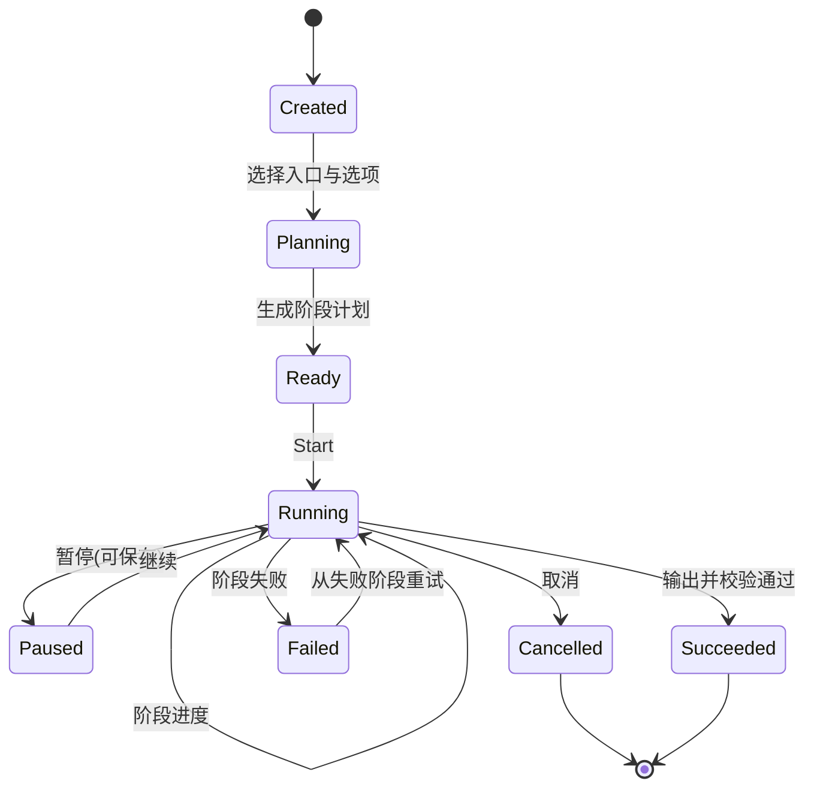
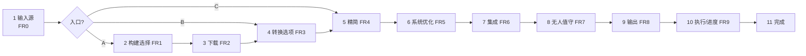
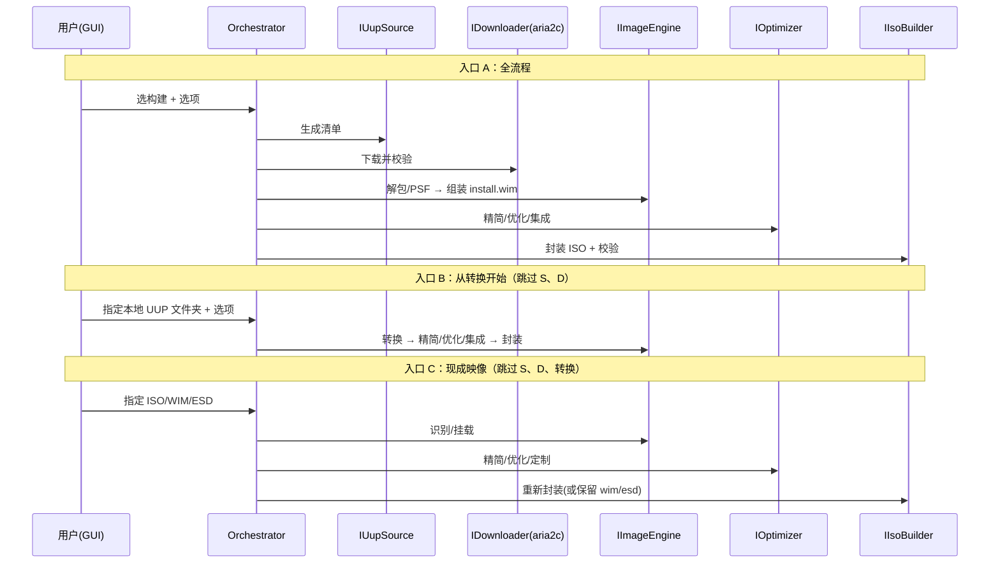

# UUP2ISO GUI 界面与框架设计

> 版本：v0.1（草案）
> 依据：`docs/需求分析.md`（FR0–FR10）
> 配套：`docs/软件架构图.md`、`docs/软件流程图.md`
> 技术栈：C# / .NET 8，Windows 10/11 x64
> 交付物：GUI 界面规格 + 软件框架设计（可指导编码）

---

## 1. 文档说明

本文档在需求分析基础上，给出 UUP2ISO 的**界面设计**与**软件框架设计**，覆盖：

- GUI 技术选型（解决需求文档中 WPF vs WinUI 3 的开放问题）；
- 分层架构、解决方案与项目结构、核心接口；
- 流水线/任务模型（多入口、可裁剪阶段、可中断续跑）；
- 各界面（页面）的布局、交互与线框；
- GUI 与 CLI 的复用关系；
- 分期实现建议。

术语沿用需求文档：**入口 A/B/C**、**FR0–FR10**、状态阶段（下载/转换/精简/优化/集成/无人值守/输出）。

---

## 2. 设计目标与原则

1. **对齐需求**：GUI 的每一项能力都能映射到 FR0–FR10，无孤立功能。
2. **多入口优先**：向导首页先选输入源（A 在线 / B 本地 UUP 文件夹 / C 现成 ISO/WIM/ESD），后续步骤**自动裁剪**（FR0）。
3. **双档用户**：默认「向导式」面向普通用户；「高级」可跳步、编辑任务配置、直连 CLI 参数。
4. **长任务可控**：下载/转换/精简等长任务支持进度、取消、失败定位、断点续跑（非功能・健壮性）。
5. **单一内核**：GUI 与 CLI 共享同一 Core/Application，行为一致（FR9 验收）。
6. **安全与合规**：危险操作（高风险优化项、永久删除）明确二次确认；不内置激活/绕过授权逻辑。
7. **可维护**：模块化、外部工具可插拔、统一错误模型。

---

## 3. 技术选型与决策

### 3.1 GUI 框架：WPF vs WinUI 3

| 维度 | WPF（.NET 8） | WinUI 3 / Windows App SDK |
|---|---|---|
| 成熟度/稳定性 | 高，长期支持 | 中，迭代中仍存在边界问题 |
| 部署 | 单文件/xcopy 即可，无需额外运行时 | 需 Windows App SDK 运行时/Bootstrapper 或 MSIX |
| 管理员权限运行 | 直接支持（提升清单） | 非打包提升运行较绕 |
| 现代化外观 | 需 Fluent 控件库 | 原生 Fluent |
| 生态/控件库 | 丰富（WPF-UI / HandyControl / MahApps） | 较少 |
| 与外部进程/文件密集操作 | 成熟 | 可行但复杂度高 |
| 中文生态/资料 | 丰富 | 一般 |

**决策：采用 WPF + .NET 8**，配合 Fluent 风格控件库（首选 **WPF-UI**，备选 **HandyControl**）。

理由：本工具是**以管理员运行、集成大量外部进程与文件操作的系统级工具**，部署越简单越好；WPF 在提升运行、单文件发布、稳定性与生态上更契合，现代外观可由控件库补足。WinUI 3 作为备选记录在开放问题中。

### 3.2 语言与运行时

- 语言：C#（最新版本）
- 运行时：.NET 8（Windows）
- 目标：`net8.0-windows`，仅 x64

### 3.3 关键第三方库

| 用途 | 库 |
|---|---|
| MVVM 源生成 | `CommunityToolkit.Mvvm`（ObservableProperty/RelayCommand） |
| 依赖注入/Host | `Microsoft.Extensions.Hosting` + `DependencyInjection` |
| 日志 | `Microsoft.Extensions.Logging` + `Serilog`（文件滚动） |
| 序列化 | `System.Text.Json`（任务配置/预设/设置） |
| 客户端校验 | `CommunityToolkit.Mvvm` 验证 + 自定义 Rule |
| UI 控件库 | `WPF-UI`（Fluent 主题、导航、对话框） |
| 图标 | Segoe Fluent Icons / Segoe MDL2 |
| 单元测试 | `xUnit` + `FluentAssertions` |

> 除 UI 相关库外，其余均下沉到 Core/Infrastructure，保证 CLI 无 UI 依赖。

---

## 4. 总体架构

### 4.1 分层

```mermaid
flowchart TB
  subgraph P[呈现层 Presentation]
    GUI[UUP2ISO.Gui (WPF/MVVM)]
    CLI[UUP2ISO.Cli]
  end
  subgraph A[应用层 Application]
    ORCH[PipelineOrchestrator]
    SESS[TaskSession / 状态机]
    DTO[命令与 DTO / 进度上报]
  end
  subgraph C[领域层 Core]
    MODEL[领域模型 / 预设 / 选项]
    IFACE[接口: IUupSource/IDownloader/IImageEngine/IOptimizer/IIsoBuilder/IPresetStore/ISettings]
  end
  subgraph I[基础设施层 Infrastructure]
    SRC[UupDumpSource]
    DL[Aria2Downloader + ToolFetcher]
    IMG[WimlibImageEngine / DismImageEngine]
    OPT[SystemOptimizer (DISM++ 式)]
    ISO[OscdimgIsoBuilder]
    PROC[ProcessRunner / 日志解析]
    STORE[SettingsStore / PresetStore / 缓存]
  end
  GUI --> A
  CLI --> A
  A --> C
  I -.实现.-> C
  A --> I
```

依赖方向始终向内（GUI/CLI → Application → Core ← Infrastructure）。

### 4.2 解决方案与项目结构

```
UUP2ISO.sln
├─ src/
│  ├─ UUP2ISO.Core/                 # 领域模型与接口（无外部依赖）
│  │  ├─ Models/                    # BuildInfo, UupFile, ImageInfo, Edition, PipelineContext ...
│  │  ├─ Pipeline/                  # Stage 定义, 阶段基类, 上下文
│  │  ├─ Options/                   # ConvertOptions, SlimOptions, OptimizeOptions, IntegrateOptions, UnattendOptions, OutputOptions
│  │  ├─ Presets/                   # Preset 模型与校验
│  │  ├─ Abstractions/              # IUupSource, IDownloader, IImageEngine, IOptimizer, IIsoBuilder, IPresetStore, ISettings
│  │  └─ Errors/                    # 统一错误类型与退出码
│  ├─ UUP2ISO.Application/          # 编排与用例
│  │  ├─ Pipeline/                  # PipelineOrchestrator, StagePlanner（按入口裁剪）
│  │  ├─ TaskSession/               # 任务状态机、断点续跑
│  │  ├─ Settings/                  # 设置服务
│  │  └─ Progress/                  # IProgress 上报模型
│  ├─ UUP2ISO.Infrastructure/
│  │  ├─ Source/                    # UupDumpSource（基址可配）
│  │  ├─ Download/                  # Aria2Downloader, Aria2ToolFetcher, 校验/续传
│  │  ├─ Imaging/                   # WimlibImageEngine, DismImageEngine, ImageEngineRouter
│  │  ├─ Optimize/                  # SystemOptimizer, 清理清单, tweak 清单, CompactOS
│  │  ├─ Iso/                       # OscdimgIsoBuilder
│  │  ├─ Process/                   # ProcessRunner, 进度/日志解析器
│  │  └─ Storage/                   # SettingsStore, PresetStore, ManifestCache
│  ├─ UUP2ISO.Gui/                  # WPF（仅依赖 Application/Core）
│  │  ├─ App.xaml(.cs)              # Host + DI 引导
│  │  ├─ Views/                     # 页面/对话框
│  │  ├─ ViewModels/                # MVVM
│  │  ├─ Controls/                  # 自定义控件（日志查看、风险徽章等）
│  │  ├─ Resources/                 # 主题、图标、本地化
│  │  └─ Navigation/                # 导航服务、向导步骤引擎
│  └─ UUP2ISO.Cli/
├─ tests/
│  ├─ UUP2ISO.Core.Tests/
│  └─ UUP2ISO.Application.Tests/
└─ docs/
```

### 4.3 核心接口（契约）

| 接口 | 职责 | 主要方法（示意） |
|---|---|---|
| `IUupSource` | 构建查询/清单（基址可配） | `GetBuildsAsync`, `GetBuildDetailAsync`, `BuildManifestAsync` |
| `IDownloader` | aria2c 下载/校验/续传 | `DownloadAsync(manifest, options, progress, ct)` |
| `IToolProvider` | 外部工具定位与 aria2c 自动获取 | `EnsureAsync(ToolKind)`, `Locate(ToolKind)` |
| `IImageEngine` | 挂载/导出/转换 | `MountAsync`, `UnmountAsync`, `ExportAsync`, `GetImagesAsync` |
| `IOptimizer` | 空间回收/tweak/CompactOS | `ReclaimAsync`, `ApplyTweaksAsync`, `CompactAsync` |
| `IIsoBuilder` | ISO 封装 | `BuildAsync(isoOptions)` |
| `IPresetStore` | 精简/优化/集成/无人值守预设 | `List/Save/Load/Export/Import` |
| `ISettings` | 全局设置 | `Get<T>/Set<T>/SaveAsync` |
| `IPipelineOrchestrator` | 阶段编排 | `Plan(entry, options)`, `RunAsync(session, ct)` |

---

## 5. 核心框架设计

### 5.1 流水线任务模型

**阶段（Stage）固定枚举，任务由「输入源 + 起始阶段 + 各阶段选项」定义**（对齐 FR0）：

| Stage | 对应需求 | 输入→输出 |
|---|---|---|
| `Fetch`（选构建+下载） | FR1, FR2 | 构建选择 + 清单 → 本地 UUP 文件夹 |
| `Convert` | FR3 | UUP 文件夹 / 本地文件夹 → `install.wim/esd` + ISO 骨架 |
| `Slim` | FR4 | 映像 → 精简后映像 |
| `Optimize` | FR5 | 映像 → 优化后映像 |
| `Integrate` | FR6 | 映像 → 集成后映像 |
| `Unattend` | FR7 | 选项 → `autounattend.xml`/`unattend.xml` |
| `Output` | FR8 | 组装文件 → ISO/wim/esd + 校验 |

**入口裁剪表**（`StagePlanner` 依据）：

| 入口 | 起始 Stage | 执行阶段序列 |
|---|---|---|
| A 在线构建 | `Fetch` | Fetch → Convert → Slim → Optimize → Integrate → Unattend → Output |
| B 本地 UUP 文件夹 | `Convert` | Convert → Slim → Optimize → Integrate → Unattend → Output |
| C 现成 ISO/WIM/ESD | `Slim`/`Optimize`/`Unattend` | （解析/挂载）→ 所选阶段 → Output |

用户可在任意入口后**跳过可选阶段**（如仅精简不集成）。

### 5.2 任务状态机与续跑



- `TaskSession` 持久化 `PipelineContext`（当前阶段、已完成文件哈希、选项）到 `%LocalAppData%\UUP2ISO\tasks\{id}.json`，支持 `--resume` / GUI「继续上次」。
- 失败重试仅重跑失败阶段（原子性：不产出半成品，见非功能）。

### 5.3 进度与日志上报

- `IProgress<StageProgress>`：`{ Stage, Percent, Message, SubPercent }`，供进度条与状态栏。
- `ILogSink`：结构化日志（时间、级别、阶段、外部工具原始行），UI 与文件共用。
- 外部工具（aria2c/DISM/wimlib/oscdimg）输出经 `ProcessRunner` 解析为进度（如 aria2c `%`、DISM 百分比），原始行进入日志面板。

### 5.4 配置、设置与预设（三分离）

| 类型 | 说明 | 存储 |
|---|---|---|
| **AppSettings** | 全局设置（数据源地址、aria2c 获取、代理、输出目录、语言、工具路径）FR10.4 | `%LocalAppData%\UUP2ISO\settings.json` |
| **TaskConfig** | 单个任务全流程（输入源、起始阶段、各阶段选项、输出规则）FR9.1 | 用户选择保存路径（JSON/YAML） |
| **Preset** | 可复用的精简/优化/集成/无人值守片段 FR4.4/FR5.6 | `%LocalAppData%\UUP2ISO\presets\*.json` |

优先级：**CLI 参数/任务配置 > AppSettings**。

### 5.5 工具定位与 aria2c 自动获取

- `IToolProvider.EnsureAsync`：启动自检时校验 `aria2c/7z/wimlib-imagex/DISM/oscdimg`；`aria2c` 缺失时按设置地址自动下载到 `tools\` 并 SHA256 校验（FR2.2/FR10.3）。
- 失败给出可点击的手动获取指引；不解压/下载二进制以外的隐蔽行为。

### 5.6 统一错误模型与退出码

| 类型 | 退出码 | UI 表现 |
|---|---|---|
| 成功 | 0 | 绿色完成页 |
| 完成但有警告 | 1 | 黄色提示，可查看原因 |
| 阶段失败 | 2 | 红色错误卡 + 「查看日志」「重试本阶段」 |
| 用户取消 | 3 | 中性提示 |
| 参数/依赖错误 | 4 | 前置校验拦截，指明缺失项 |

错误对象含：阶段、涉及文件、外部工具、返回码、原始输出片段。

---

## 6. GUI 界面设计

### 6.1 信息架构与导航

主窗口左侧导航（NavView）：

1. **新建任务**（向导）
2. **任务**（历史/进行中，可继续）
3. **预设**（精简/优化/集成/无人值守预设管理）
4. **设置**（数据源地址、aria2c、代理、输出目录、语言）
5. **工具与依赖**（自检结果、aria2c 获取、ADK/oscdimg 检测）
6. **日志**（会话日志查看）
7. **关于**

> 面向普通用户时默认进入「新建任务」向导；高级用户可切到「任务」直接加载配置。

### 6.2 主窗口布局

```
┌───────────────────────────────────────────────────────────────────────────┐
│  UUP2ISO                                          ▁ □ ✕   （Fluent 标题栏） │
├───────────────┬───────────────────────────────────────────────────────────┤
│  新建任务      │                                                           │
│  任务          │                    内容区（页面/向导步骤）                  │
│  预设          │                                                           │
│  设置          │                                                           │
│  工具与依赖    │                                                           │
│  日志          │                                                           │
│  关于          │                                                           │
│               │                                                           │
├───────────────┴───────────────────────────────────────────────────────────┤
│ [阶段: 转换] ████████████░░░░ 62%   ├─ 展开日志 ─┤   [取消]                 │
└───────────────────────────────────────────────────────────────────────────┘
```

- 底部状态栏：当前阶段、总进度、取消/暂停、日志展开开关。
- 长任务运行时状态栏常驻，可切换到「日志」页看详情。

### 6.3 向导步骤与裁剪



- 向导左侧或顶部显示步骤条；不可用步骤灰显（如入口 C 无「构建选择/下载/转换」）。
- 每步右上角「保存任务配置」；顶部「高级模式」开关可展开底层参数。

### 6.4 关键页面线框

#### 6.4.1 第 1 步・输入源（FR0）

```
┌ 选择输入源 ────────────────────────────────────────────────────────────┐
│  ○ (A) 在线 UUP 构建      从数据源下载最新 Win10/11 并全程构建          │
│  ○ (B) 本地 UUP 文件夹    已有 UUP 文件，从「转换」开始                 │
│      [ 选择文件夹... ]  D:\UUP\26100.1_amd64_zh-cn                      │
│  ○ (C) 现成映像文件       ISO / WIM / ESD，从「精简/优化/定制」开始     │
│      [ 选择文件... ]    D:\ISO\win11.iso                                │
│                                                                        │
│  起始阶段： [自动推断 ▼]  (可手动指定更靠后的阶段)                      │
│                                   [下一步 →]                           │
└────────────────────────────────────────────────────────────────────────┘
```

- 选择后自动识别类型/内容（FR0.5）；识别失败就地提示。
- 入口 C 显示识别到的 edition 列表与是否加密/多分卷。

#### 6.4.2 第 2 步・构建选择（FR1，仅入口 A）

```
┌ 选择构建 ──────────────────────────────────────────────────────────────┐
│ 通道[retail ▼] 架构[x64 ▼] 语言[zh-cn ▼] 版本[全部 ▼]  搜索[______]     │
│ ┌────────────────────────────────────────────────────────────────────┐ │
│ │ ● 26100.1742  Windows 11, version 24H2   retail  2024-10-08        │ │
│ │   语言: zh-cn,en-us   版本: Home/Pro/Edu   KB5044284               │ │
│ │ ○ 22631.4460  Windows 11, version 23H2   retail  2024-11-12        │ │
│ └────────────────────────────────────────────────────────────────────┘ │
│ 数据源: https://uupdump.net/   [更改]        [刷新]      [下一步 →]    │
└────────────────────────────────────────────────────────────────────────┘
```

- 顶部数据源条显示当前地址并可跳设置（FR1.4）。

#### 6.4.3 第 3 步・下载（FR2）

```
┌ 下载 ──────────────────────────────────────────────────────────────────┐
│ 文件: 24/31  总进度 ██████████░░░░ 68%   速度 12.4 MB/s   剩余 ~04:12   │
│ 并发[8] 限速[不限 ▼]  代理[系统 ▼]                                     │
│ ┌ 文件列表 ──────────────────────────────────────────────────────────┐ │
│ │ ✓ Microsoft-Windows-...cab    12.3MB / 12.3MB   SHA1 ✓            │ │
│ │ ⧗ install.wim.psf            2.1GB / 3.4GB                        │ │
│ │ ✗ ...esd                     0B / 800MB            重试 [↻]        │ │
│ └────────────────────────────────────────────────────────────────────┘ │
│ [暂停] [取消]   失败清单: 1    [仅重试失败]                [下一步 →]  │
└────────────────────────────────────────────────────────────────────────┘
```

- 未获取 aria2c 时先提示并自动获取（FR2.2），失败给出指引。

#### 6.4.4 第 4 步・转换选项（FR3，对齐 ConvertConfig）

```
┌ 转换选项 ──────────────────────────────────────────────────────────────┐
│ 输出  ○ WIM   ● ESD(wim2esd)   ○ 拆分 WIM(wim2swm)      [ ] 跳过 ISO    │
│ 压缩  [LZX ▼] (none/XPRESS/LZX/LZMS)                                   │
│ ☑ 集成更新(AddUpdates)   ☑ 组件清理(Cleanup)   ☐ 重置基础(ResetBase)    │
│ ☑ 启用 .NET 3.5(NetFx3)  WinRE[更新 ▼](保留/更新/跳过)  ☐ 仅升级         │
│ 保留版本:  [✓]Home [✓]Pro [✓]Edu [ ]Pro N ...  虚拟版本[自定义…]        │
│ 卷标: [CCCOMA_X64FRE_ZH-CN_DV9]                                        │
│                                        [高级…]           [下一步 →]     │
└────────────────────────────────────────────────────────────────────────┘
```

- 每个选项悬停显示对应 `ConvertConfig.ini` 键名与说明。

#### 6.4.5 第 5 步・精简（FR4）

```
┌ 精简 ──────────────────────────────────────────────────────────────────┐
│ [Appx 应用] [组件与包] [硬件检查]                                       │
│ ┌ Appx ───────────────────────────────────────────┐  预设 [安全精简▼]  │
│ │ ☑ Xbox  ☑ News  ☑ Weather  ☑ Teams  ☑ OneDrive │  [导入][导出]      │
│ │ ☐ Clipchamp  ☐ 地图  ☐ 便笺  ☐ 联系支持         │                    │
│ └─────────────────────────────────────────────────┘                    │
│ ⚠ 移除后不可恢复；红色项与当前勾选存在依赖冲突：[查看]                  │
│                                                   [下一步 →]           │
└────────────────────────────────────────────────────────────────────────┘
```

- 依赖矩阵冲突就地阻断（FR4.2）；切换 Tab 分别配置组件与硬件检查绕过（FR4.3）。

#### 6.4.6 第 6 步・系统优化（FR5，DISM++ 式）

```
┌ 系统优化 ──────────────────────────────────────────────────────────────┐
│ 预设[推荐 ▼] [导入][导出]                 [全选] [全不选] [展开说明]    │
│ ┌ 分类 ────────────┬ 优化项 ────────────────────────────────────────┐  │
│ │ 空间回收         │ ☑ 组件存储清理(WinSxS)         预计释放 1.2GB    │  │
│ │ 隐私与遥测  ◀    │ ☑ 更新缓存清理                 预计释放 320MB    │  │
│ │ 系统行为         │ ☐ 临时文件/日志清理             预计释放 90MB     │  │
│ │ 资源管理器/任务栏│ ☑ 关闭休眠(hiberfil)            风险:低   [说明]  │  │
│ │ 网络             │ ☐ 关闭预留存储                  风险:低          │  │
│ │ Windows Update   │ ☐ 关闭 Defender 实时保护        风险:高⚠ 需确认   │  │
│ │ 安全             │ ☑ CompactOS 压缩                风险:中          │  │
│ └──────────────────┴────────────────────────────────────────────────┘  │
│ (高项默认关闭；勾选高风险项弹出确认)                  [下一步 →]        │
└────────────────────────────────────────────────────────────────────────┘
```

- 左树分组、右侧项列表 + 风险徽章（低/中/高）+ 逐项说明（FR5.5）。
- 「空间回收」显示预计释放空间；「系统行为」含休眠/还原/预留存储等。

#### 6.4.7 第 7 步・集成（FR6）

```
┌ 集成 ──────────────────────────────────────────────────────────────────┐
│ [更新] [驱动] [语言包] [注册表]                                        │
│ ┌ 驱动 ─────────────────────────────────────────────┐                   │
│ │ 目标:  ● boot.wim(WinPE)  ● install.wim(系统)      │                   │
│ │ [添加文件夹...] D:\drivers     已扫描 42 个 .inf   │                   │
│ │ 报告: ✓38 适用  ⚠3 未签名  ✗1 不适用  [详情]      │                   │
│ └────────────────────────────────────────────────────┘                  │
│                                                   [下一步 →]           │
└────────────────────────────────────────────────────────────────────────┘
```

#### 6.4.8 第 8 步・无人值守定制（FR7）

```
┌ 无人值守定制 ──────────────────────────────────────────────────────────┐
│ 模板[普通用户 ▼]    ☑ 生成 autounattend.xml   ☑ 生成 unattend.xml      │
│ ┌ 分区 ──────────┬ 区域/语言 ─────┬ 账户 ──────────┬ 脚本 ───────────┐  │
│ │ ☑ 自动分区     │ 语言 zh-CN    │ ○ 本地账户     │ FirstLogon:     │  │
│ │   GPT/MBR:GPT  │ 时区 China    │  名[User]      │  1. setup.cmd   │  │
│ │                │  键盘 中文     │ ☑ 跳过 OOBE    │  [+ 添加]       │  │
│ │                │ 产品密钥[___] │ ☑ 自动登录     │                 │  │
│ └────────────────┴────────────────┴────────────────┴─────────────────┘  │
│ [校验 schema]   校验通过 ✔                              [下一步 →]      │
└────────────────────────────────────────────────────────────────────────┘
```

#### 6.4.9 第 9 步・输出（FR8）

```
┌ 输出设置 ──────────────────────────────────────────────────────────────┐
│ 输出目录 [D:\OUT\        ] [浏览]                                      │
│ 文件命名 {edition}_{build}_{arch}_{lang}.iso                            │
│ 预览: Pro_26100_amd64_zh-cn.iso                                        │
│ ☑ 保留中间 wim/esd   ☑ 生成 SHA256   ☑ 生成 readme    ☑ 校验可挂载      │
│                                                   [开始执行 →]          │
└────────────────────────────────────────────────────────────────────────┘
```

#### 6.4.10 第 10 步・执行/进度（FR9）

```
┌ 执行中 ────────────────────────────────────────────────────────────────┐
│ 阶段: ● 下载 ✔ → ● 转换 ✔ → ● 精简 ⧗ → ○ 优化 → ○ 定制 → ○ 输出        │
│ 总进度 ██████████░░░░░ 58%    当前: 移除 Appx (7/24)                    │
│ ┌ 日志 ──────────────────────────────────────────────────────────────┐ │
│ │ [14:02:11] INFO  DISM /Remove-ProvisionedAppxPackage ...            │ │
│ │ [14:02:13] WARN  依赖冲突已跳过: ...                                │ │
│ └────────────────────────────────────────────────────────────────────┘ │
│ [暂停] [取消] [复制日志]                                               │
└────────────────────────────────────────────────────────────────────────┘
```

- 阶段串可点击查看已完成阶段的详情；失败时该阶段标红并出现「重试本阶段」。

#### 6.4.11 设置页（FR10.4）

```
┌ 设置 ──────────────────────────────────────────────────────────────────┐
│ [常规] [数据源] [下载] [工具与依赖] [高级]                              │
│ ┌ 数据源 ────────────────────────────────────────────────────────────┐ │
│ │ 数据源网址  [https://uupdump.net/        ] [测试连接] ✔ 可用        │ │
│ │ 备用地址    [+ 添加]                                                │ │
│ └────────────────────────────────────────────────────────────────────┘ │
│ ┌ 工具与依赖 ────────────────────────────────────────────────────────┐ │
│ │ aria2c        [✓ 已获取 v1.36.0]  来源[官方发布 ▼] [重新获取]       │ │
│ │ 7-Zip         [✓ 内置]     wimlib-imagex [✓ 内置]                   │ │
│ │ DISM          [✓ 系统内置]                                          │ │
│ │ oscdimg       [✗ 未找到]  → 需安装 Windows ADK [获取指引]           │ │
│ └────────────────────────────────────────────────────────────────────┘ │
│ [保存]                                                                 │
└────────────────────────────────────────────────────────────────────────┘
```

- 数据源地址保存前做可用性校验，失败可一键回退默认（FR1.4）。

#### 6.4.12 预设管理

- 列表 + 新建/复制/重命名/导入/导出；分「精简 / 优化 / 集成 / 无人值守」四类，也可整体打包为一份任务配置。

### 6.5 交互细节

- **校验前置**：向导「下一步」前校验必填；错误就地红字，不弹窗打断。
- **危险确认**：删除性精简、高风险优化项、覆盖已有输出 → 二次确认，并记录日志。
- **长任务**：可取消/暂停；关闭窗口时提示可选择后台继续（最小化到托盘）。
- **状态栏常驻**进度；任务完成弹系统通知（可关）。
- **无障碍/键盘**：全流程可用键盘操作；Tab 顺序合理。

### 6.6 视觉与主题

- Fluent 风格（WPF-UI）；支持跟随系统亮/暗主题，可手动切换。
- 语义色：正常/进行/警告/错误；风险徽章低=灰、中=橙、高=红。
- 图标统一使用 Segoe Fluent Icons。

### 6.7 国际化

- 界面中/英（资源文件 `.resx` 或本地化 json）；ISO 语言与界面语言**独立**（非功能・国际化）。

---

## 7. GUI 与 CLI 复用

- 两者均通过 `IPipelineOrchestrator` 驱动，输入同一 `TaskConfig`。
- CLI 参数（`--input`、`--source-url`、`--config`、`--dry-run`、`--resume` 等）与向导字段一一映射；`--dry-run` 输出将执行的阶段与外部命令。
- 输出 JSON 结果供 CI 消费；退出码见 5.6。

```
用户输入 ─┬─ GUI 向导 ─┐
          └─ CLI 参数 ─┴─► TaskConfig ─► Orchestrator ─► Core/Infrastructure ─► 结果/日志
```

---

## 8. 三入口关键流程（时序）



---

## 9. 开发规范（约定）

- **MVVM**：View 只做布局与绑定；逻辑在 ViewModel；`CommunityToolkit.Mvvm` 源生成属性/命令。
- **导航**：`INavigationService` 管理页面与向导步骤；步骤可回退，选项随 `TaskConfig` 双向绑定。
- **异步**：所有 I/O 异步；长任务传 `CancellationToken`；UI 线程不阻塞。
- **可测试**：ViewModel 与 Orchestrator 不依赖 UI 类型，便于单测。
- **无魔法**：不在 UI 线程调用外部进程；进程输出统一走 `ProcessRunner`。
- **禁止**：任何激活/授权绕过逻辑（合规）。

---

## 10. 分期实现建议（对齐里程碑）

| 阶段 | GUI/框架交付 |
|---|---|
| **MVP** | 解决方案骨架 + DI/Host + CLI 优先；GUI 仅「新建任务」最小向导（入口 A/B/C 选择 + 执行 + 进度/日志）+ 设置页 |
| **二期** | 完善向导：构建选择、下载、转换、精简、优化页面 + 预设管理 + 主题/国际化 |
| **三期** | 集成页 + 无人值守可视化 + schema 校验 |
| **四期** | 批处理/CI 支持面板、CompactOS/服务预置等优化项扩展、托盘/后台继续 |

---

## 11. 开放问题

- [ ] 控件库最终确定：WPF-UI vs HandyControl。
- [ ] 向导形态：单窗口分步控件 vs 多页导航（是否允许非线性跳转）。
- [ ] 长任务后台继续的实现（托盘常驻 vs 独立进程/服务）。
- [ ] 任务配置与 AppSettings 是否统一为一种文件格式与位置。
- [ ] 优化项清单的更新机制（内置 vs 可在线刷新，见需求文档待办）。
- [ ] `--dry-run` 在 GUI 中的呈现形式（预览面板）。
