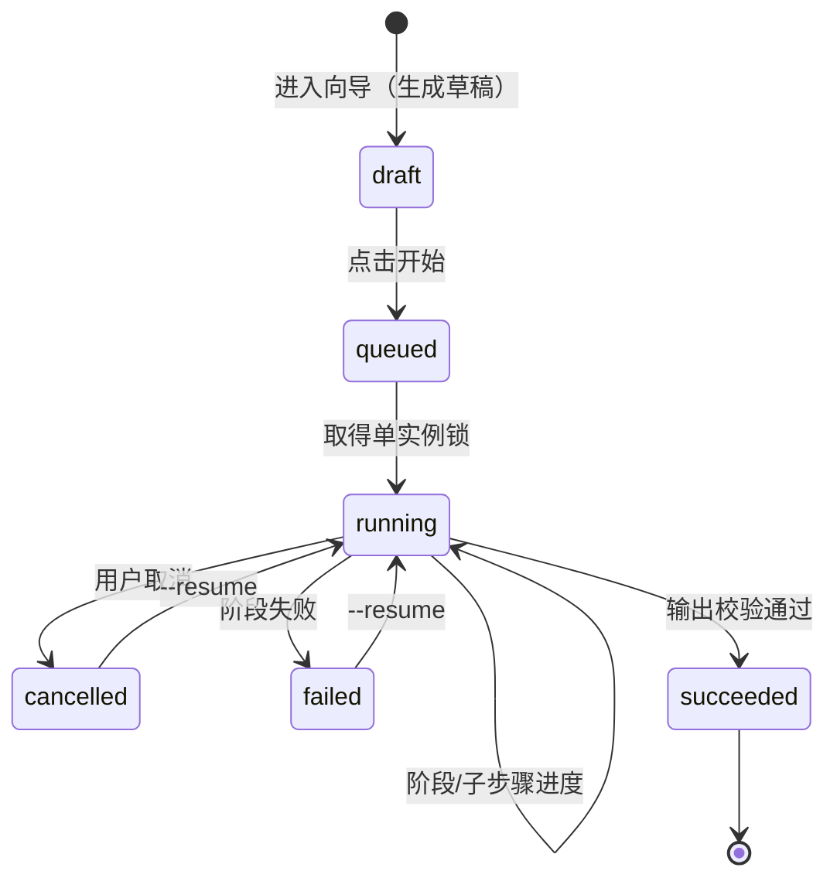
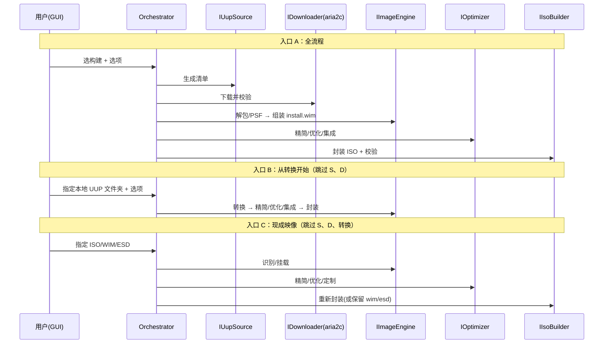

# UUP2ISO GUI 界面与框架设计

> 版本：v0.10
> 分类：设计（结构与界面） ｜ 目录：`docs/设计/`（草案）
> 依据：`docs/需求/需求分析.md`（FR0–FR10）
> 配套：`docs/设计/软件架构图.md`、`docs/设计/软件流程图.md`
> 技术栈：Python 3.12–3.13 / PySide6，Windows 10/11 x64
> 交付物：GUI 界面规格 + 软件框架设计（可指导编码）
>
> v0.10（对齐 M0 实现，WP0-T1/T2/T2a）：Fluent 控件库改为 **`PySide6-Fluent-Widgets`**；Python 版本上限锁 `<3.14`；配套文档路径修正到 `docs/设计/`。

---

## 1. 文档说明

本文档在需求分析基础上，给出 UUP2ISO 的**界面设计**与**软件框架设计**，覆盖：

- GUI 技术选型（Python GUI 框架对比与决策：PySide6 + PyQt-Fluent-Widgets）；
- 开发与运行环境约定（工作空间虚拟环境 `.venv`，强制）；
- 分层架构、工程结构与包结构、核心接口；
- 流水线/任务模型（多入口、可裁剪阶段、可中断续跑）；
- 各界面（页面）的布局、交互与线框；
- GUI 与 CLI 的复用关系；
- 分期实现建议。

术语沿用需求文档：**入口 A/B/C**、**FR0–FR10**、状态阶段（下载/转换/精简/优化/集成/无人值守/输出）。

---

## 2. 设计目标与原则

1. **对齐需求**：GUI 的每一项能力都能映射到 FR0–FR10，无孤立功能。
2. **多入口优先**：向导首页先选输入源（A 在线 / B 本地 UUP 文件夹 / C 现成 ISO/WIM/ESD），后续步骤**自动裁剪**（FR0）。
3. **双档用户**：默认「向导式」面向普通用户；「高级」可跳步、编辑任务配置，并把配置导出给 CLI 复用。
4. **长任务可控**：下载/转换/精简等长任务支持进度、取消、失败定位、断点续跑（非功能・健壮性）。
5. **单一内核**：GUI 与 CLI 共享同一 Core/Application，行为一致（FR9 验收）。
6. **安全与合规**：危险操作（高风险优化项、永久删除）明确二次确认；不内置激活/绕过授权逻辑。
7. **可维护**：模块化、外部工具可插拔、统一错误模型。

---

## 3. 技术选型与决策

### 3.1 GUI 框架：Tkinter vs PySide6 vs wxPython

| 维度 | Tkinter（内置） | PySide6（Qt 6，LGPL） | wxPython |
|---|---|---|---|
| 成熟度/稳定性 | 高但控件原始 | 高，Qt 官方长期维护 | 中，迭代较慢 |
| 现代化外观 | 差，需大量自绘 | 好；有 Fluent 风格控件库 | 一般 |
| Fluent 控件生态 | 无 | **PyQt-Fluent-Widgets**（导航视图、卡片、亮暗主题、中文文档） | 少 |
| 管理员权限运行 | 直接支持 | 直接支持（PyInstaller `--uac-admin` 清单） | 支持 |
| 长任务/线程模型 | 弱 | **QThread + 信号槽**，成熟；UI 不阻塞 | 一般 |
| 与外部进程/文件密集操作 | 可行但费劲 | 成熟（信号槽回传进度/日志） | 可行 |
| 打包体积影响 | 极小 | +40–60MB（PyInstaller，**代价已接受**） | 中 |
| 中文生态/资料 | 一般 | 丰富 | 一般 |

**决策：采用 PySide6 + PyQt-Fluent-Widgets**。

理由：本工具是**以管理员运行、集成大量外部进程与文件操作的系统级工具**，需要成熟的线程模型承载长任务进度回调；PyQt-Fluent-Widgets 提供与线框图对齐的 Fluent 导航视图、卡片、风险徽章与亮暗主题；Qt 官方 PySide6 为 LGPL 许可，分发友好。Tkinter 因控件质感与线程模型不足被排除；wxPython 因控件生态弱被排除。

### 3.2 语言与运行时

- 语言：Python 3.12–3.13（x64）。**上限锁 `<3.14`**：PySide6 尚无 3.14 wheel，3.14 无法安装依赖栈；
  待 PySide6 发布 3.14 wheel 后再放开（需同步 `pyproject.toml` 的 `requires-python` 与本文）。
- **开发与运行环境（强制约定）**：
  - **所有脚本（开发、测试、构建、打包、自动化代理）一律在工作空间根目录的虚拟环境 `.venv` 中运行**，不得使用系统 Python 主环境；
  - 首次初始化：`python -m venv .venv`；
  - 此后统一以 `.venv\Scripts\python` 执行（安装：`-m pip install -e ".[dev]"`；测试：`-m pytest`；打包：`-m PyInstaller ...`）；
  - 禁止任何不带 `.venv` 前缀的全局 `pip install` 或脚本运行。
- 发布产物：PyInstaller **单目录**打包（**便携式** zip，解压即用；程序、日志、配置、预设、任务、工具同目录；内嵌解释器与依赖，目标机器免装 Python；**打包体积与启动时间代价已明确接受**），管理员提升经 `--uac-admin` 清单实现。

### 3.3 关键第三方库

| 用途 | 库 |
|---|---|
| GUI 框架 | `PySide6`（Qt 6 官方 Python 绑定） |
| Fluent 控件库 | `PySide6-Fluent-Widgets`（Fluent 主题、导航、对话框；**PySide6 变体**） |
| 视图逻辑 | Qt 信号槽 + Presenter 模式（不引入额外 MVVM 框架） |
| 依赖注入/组合根 | `dependency-injector`（或组合根模块手动装配） |
| 日志 | `logging` + 自定义文件处理器（每次启动一个文件、三条件清理、审计分流，见 `日志规范.md`） |
| 序列化与模型 | `pydantic`（任务配置/预设/设置 + 校验） |
| 规则库校验 | `jsonschema`（draft-07，直接消费 `rules.schema.json`） |
| CLI | `typer`（最小命令集 `--config`/`--dry-run`/`--resume`/`--debug`、退出码、JSON 输出） |
| XML | `lxml`（unattend 生成 + XSD schema 校验） |
| 单元测试 | `pytest` + `pytest-qt` + `dirty-equals`（断言） |
| 代码质量 | `ruff`（lint/format）+ `mypy`（类型检查） |
| 打包 | `pyinstaller`（单目录优先，`--uac-admin` 提权清单） |

> 除 UI 相关库外，其余均下沉到 core/infrastructure，保证 CLI 无 UI 依赖。
>
> **禁止 `PyQt-Fluent-Widgets`**：它基于 PyQt6，与 PySide6 并存会同时装上两套 Qt 绑定并在运行期崩溃。
> 发行名必须写 `PySide6-Fluent-Widgets`，导入名仍是 `qfluentwidgets`。
> 门禁：`tests/test_dependencies.py::test_no_dual_qt_bindings` 检测到 `PyQt6` 即失败。

---

## 4. 总体架构

### 4.1 分层

```mermaid
flowchart TB
  subgraph P[呈现层 Presentation]
    GUI[uup2iso.gui (PySide6 + Fluent)]
    CLI[uup2iso.cli]
  end
  subgraph A[应用层 Application]
    ORCH[PipelineOrchestrator]
    SESS[TaskSession / 状态机]
    DTO[命令与 DTO / 进度上报]
  end
  subgraph C[领域层 Core]
    MODEL[领域模型 / 预设 / 选项]
    IFACE[接口: IUupSource/IDownloader/IImageEngine/IOptimizer/IIsoBuilder/IPresetStore/ISettings]
  end
  subgraph I[基础设施层 Infrastructure]
    SRC[UupDumpSource]
    DL[Aria2Downloader + ToolFetcher]
    IMG[WimlibImageEngine / DismImageEngine]
    OPT[SystemOptimizer (DISM++ 式)]
    ISO[OscdimgIsoBuilder]
    PROC[ProcessRunner / 日志解析]
    STORE[SettingsStore / PresetStore / 缓存]
  end
  GUI --> A
  CLI --> A
  A --> C
  I -.实现.-> C
  A --> I
```

依赖方向始终向内（GUI/CLI → Application → Core ← Infrastructure）。

### 4.2 工程与包结构

> 所有命令（安装/测试/打包）一律在工作空间 `.venv` 虚拟环境内执行（见 §3.2）。

```
UUP2ISO/
├─ pyproject.toml                # 依赖、版本、工具链（ruff/mypy/pytest）声明
├─ .venv/                        # 工作空间虚拟环境（强制；.gitignore 排除，不入库）
├─ src/
│  ├─ uup2iso/                   # 可安装包（.venv 内 pip install -e .）
│  │  ├─ core/                   # 领域模型与接口（无外部依赖）
│  │  │  ├─ models/              # BuildInfo, UupFile, ImageInfo, Edition, PipelineContext ...
│  │  │  ├─ pipeline/            # Stage 定义, 阶段基类, 上下文
│  │  │  ├─ options/             # ConvertOptions, SlimOptions, OptimizeOptions, IntegrateOptions, UnattendOptions, OutputOptions
│  │  │  ├─ presets/             # Preset 模型与校验
│  │  │  ├─ abstractions/        # IUupSource, IDownloader, IImageEngine, IOptimizer, IIsoBuilder, IPresetStore, ISettings（typing.Protocol）
│  │  │  └─ errors/              # 统一错误类型与退出码
│  │  ├─ application/            # 编排与用例
│  │  │  ├─ pipeline/            # PipelineOrchestrator, StagePlanner（按入口裁剪）
│  │  │  ├─ task_session/        # 任务状态机、断点续跑
│  │  │  ├─ settings/            # 设置服务
│  │  │  └─ progress/            # 进度上报模型
│  │  ├─ infrastructure/         # 外部工具与存储适配
│  │  │  ├─ source/              # UupDumpSource（基址可配）
│  │  │  ├─ download/            # Aria2Downloader, Aria2ToolFetcher, 校验/续传
│  │  │  ├─ imaging/             # WimlibImageEngine, DismImageEngine, ImageEngineRouter
│  │  │  ├─ optimize/             # SystemOptimizer, 清理清单, tweak 清单, CompactOS
│  │  │  ├─ iso/                 # OscdimgIsoBuilder
│  │  │  ├─ process/              # ProcessRunner, 进度/日志解析器
│  │  │  └─ storage/             # SettingsStore, PresetStore, ManifestCache
│  │  ├─ gui/                    # PySide6（仅依赖 application/core）
│  │  │  ├─ app.py               # 组合根：装配接口实现并启动
│  │  │  ├─ views/               # 页面/对话框
│  │  │  ├─ presenters/          # 视图逻辑（对应 MVVM 之 ViewModel）
│  │  │  ├─ controls/            # 自定义控件（日志查看、风险徽章等）
│  │  │  ├─ resources/           # 主题、图标、本地化
│  │  │  └─ navigation/          # 导航服务、向导步骤引擎
│  │  ├─ cli/                    # 最小 CLI 入口（typer：run --config / --dry-run / --resume / --debug / version）
│  │  └─ __init__.py             # __version__（版本管理约定的同步点之一）
├─ tests/
│  ├─ test_core/
│  └─ test_application/
├─ rules/                        # 构建时复制到程序目录（FR4/FR5 规则库）
└─ docs/
```

### 4.3 核心接口（契约，typing.Protocol）

| 接口 | 职责 | 主要方法（示意） |
|---|---|---|
| `IUupSource` | 构建查询/清单（基址可配） | `get_builds()`, `get_build_detail()`, `build_manifest()` |
| `IDownloader` | aria2c 下载/校验/续传 | `download(manifest, options, progress, ct)` |
| `IToolProvider` | 外部工具定位与 aria2c 自动获取 | `ensure(tool_kind)`, `locate(tool_kind)` |
| `IImageEngine` | 挂载/导出/转换 | `mount()`, `unmount()`, `export()`, `get_images()` |
| `IOptimizer` | 空间回收/tweak/CompactOS | `reclaim()`, `apply_tweaks()`, `compact()` |
| `IIsoBuilder` | ISO 封装 | `build(iso_options)` |
| `IPresetStore` | 精简/优化/集成/无人值守预设 | `list()/save()/load()/export()/import_()` |
| `ISettings` | 全局设置 | `get(key)/set(key, value)/save()` |
| `IPipelineOrchestrator` | 阶段编排 | `plan(entry, options)`, `run(session, ct)` |

---

## 5. 核心框架设计

### 5.1 流水线任务模型

**阶段（Stage）固定枚举（8 个，名称唯一，见编排 §2）**，任务由「输入源 + 起始阶段 + 各阶段选项」定义（对齐 FR0）：

| Stage | 对应需求 | 输入→输出 |
|---|---|---|
| `Prepare`（P0） | FR0.4/0.5 | 输入路径 → `probe.json` + `image\`（物化/解包） |
| `Fetch`（P1） | FR1, FR2 | 构建选择 + 清单 → 本地 UUP 文件夹 |
| `Convert`（P2） | FR3 | UUP 文件夹 → `install.wim` + 骨架 + `boot.wim` |
| `Slim`（P3） | FR4 | 映像 → 精简后映像 |
| `Optimize`（P4） | FR5 | 映像 → 优化后映像 |
| `Integrate`（P5） | FR6 | 映像 → 集成后映像 |
| `Unattend`（P6） | FR7 | 选项 → `autounattend.xml`（+ 可选注入） |
| `Output`（P7） | FR8 | 组装文件 → ISO/wim/esd + 分级校验 |

**入口裁剪表**（`StagePlanner` 依据）：

| 入口 | 起始 Stage | 执行阶段序列 |
|---|---|---|
| A 在线构建 | `Fetch` | Fetch → Convert → Slim → Optimize → Integrate → Unattend → Output（`Prepare` 只做 `uup\` 就绪探测） |
| B 本地 UUP 文件夹 | `Convert` | Prepare → Convert → Slim → Optimize → Integrate → Unattend → Output |
| C 现成 ISO/WIM/ESD | `Slim` | Prepare → Slim → Optimize → Integrate → Unattend → Output |

用户可在任意入口后**跳过可选阶段**（如仅精简不集成），跳过记 `status=skipped` 并写原因。

### 5.2 任务状态机与续跑



- 状态取值**只允许** `draft` / `queued` / `running` / `succeeded` / `failed` / `cancelled` / `interrupted`（术语表 §2.2）；另有 `interrupted` 由下次启动检测得出。
- **没有 `paused`**：本期不支持「暂停/继续」，暂停语义只能通过「取消 + 续跑」实现（编排 §13 开放问题）。
- `TaskSession` 持久化 `PipelineContext`（当前阶段、已完成文件哈希、选项）到 `{程序目录}\tasks\{id}.json` 的 `runtime` 段（字段见编排 §10），支持 `--resume` / GUI「继续上次」。
- 失败重试仅重跑失败阶段（原子性：不产出半成品，见输出规范 §3）。

### 5.3 进度与日志上报

- 进度回调 `progress: Callable[[StageProgress], None]`：`{stage, percent, message, sub_percent}`，供进度条与状态栏。
- `LogSink`：纯文本结构化日志，行格式见 `日志规范.md` §2.3；字段含「时间、级别、阶段、消息」+ 键值对 `task/tool/exit/duration/file/rule/risk`；UI 与文件共用同一份。
- **只记头尾**：外部工具只写 `event=start` / `event=finish`（含返回码与耗时）；进度类行（百分比、进度条、速度/ETA）只更新进度模型，**不写入日志文件**（见 `日志规范.md` §5.2）。
- 审计事件（高风险项确认、不可逆操作、设置变更）写入独立的 `audit_*.log`，与运行日志同一启动时间戳前缀。
- 外部工具（aria2c/DISM/wimlib/oscdimg）输出经 `ProcessRunner`（`asyncio.subprocess`）分类为 `progress`/`line`/`result`，原始非进度行进入日志面板与文件。

### 5.4 配置、设置与预设（三分离）

| 类型 | 说明 | 存储 |
|---|---|---|
| **AppSettings** | 全局设置（数据源地址、aria2c 获取、代理、输出目录、语言、工具路径、日志阈值）FR10.4 | `{程序目录}\config\settings.json` |
| **TaskConfig** | 单个任务全流程（输入源、起始阶段、各阶段选项、输出规则）FR9.1 | 用户选择保存路径（JSON）；默认 `{程序目录}\tasks\` |
| **Preset** | 可复用的精简/优化/集成/无人值守片段 FR4.4/FR5.6 | `{程序目录}\presets\*.json` |

优先级：**任务配置 > AppSettings**。CLI 只指定配置文件与运行开关，不参与字段级覆盖。

> **便携分发**：以上数据与 `logs\`、`tools\` 均位于程序目录，不写系统用户目录、不写注册表；程序目录不可写时启动即报错，不静默回退。

### 5.5 工具定位与 aria2c 自动获取

- `IToolProvider.EnsureAsync`：启动自检时校验 `aria2c/7z/wimlib-imagex/DISM/oscdimg`；`aria2c` 缺失时按设置地址自动下载到 `tools\` 并 SHA256 校验（FR2.2/FR10.3）。
- 失败给出可点击的手动获取指引；不解压/下载二进制以外的隐蔽行为。

### 5.6 统一错误模型与退出码

| 类型 | 退出码 | UI 表现 |
|---|---|---|
| 成功 | 0 | 绿色完成页 |
| 完成但有警告 | 1 | 黄色提示，可查看原因 |
| 阶段失败 | 2 | 红色错误卡 + 「查看日志」「重试本阶段」 |
| 用户取消 | 3 | 中性提示 |
| 参数/依赖错误 | 4 | 前置校验拦截，指明缺失项 |
| 已有实例运行 | 5 | GUI 激活已有窗口后退出；CLI 输出 `already_running` 后退出 |

错误对象含：阶段、涉及文件、外部工具、返回码、原始输出片段。

---

## 6. GUI 界面设计

### 6.1 信息架构与导航

主窗口左侧导航（NavView）：

1. **新建任务**（向导）
2. **任务**（历史/进行中，可继续）
3. **预设**（精简/优化/集成/无人值守预设管理）
4. **设置**（数据源地址、aria2c、代理、输出目录、语言）
5. **工具与依赖**（自检结果、缺失自动获取、工具自动更新、ADK/oscdimg 检测）
6. **日志**（本次运行日志查看、打开日志目录、生成诊断包）
7. **关于**

> 面向普通用户时默认进入「新建任务」向导；高级用户可切到「任务」直接加载配置。

### 6.2 主窗口布局

```
┌───────────────────────────────────────────────────────────────────────────┐
│  UUP2ISO                                          ▁ □ ✕   （Fluent 标题栏） │
├───────────────┬───────────────────────────────────────────────────────────┤
│  新建任务      │                                                           │
│  任务          │                    内容区（页面/向导步骤）                  │
│  预设          │                                                           │
│  设置          │                                                           │
│  工具与依赖    │                                                           │
│  日志          │                                                           │
│  关于          │                                                           │
│               │                                                           │
├───────────────┴───────────────────────────────────────────────────────────┤
│ [阶段: 转换] ████████████░░░░ 62%   ├─ 展开日志 ─┤   [取消]                 │
└───────────────────────────────────────────────────────────────────────────┘
```

- 底部状态栏：当前阶段、总进度、取消/暂停、日志展开开关。
- 长任务运行时状态栏常驻，可切换到「日志」页看详情。

### 6.3 向导步骤与裁剪


- **共 10 步**（与 `GUI交互规格-向导页.md` §1.2、§2 一致）：⑩ 是「确认」，不是「执行/进度」——执行与日志在同级的**执行页**（`GUI交互规格-设置与对话框.md` §6），不占向导步骤。
- 向导左侧或顶部显示步骤条；不可用步骤灰显（如入口 C 无「构建选择/下载/转换」），隐藏的步骤不占位。
- 每步右上角「保存任务配置」；三档模式（简单/标准/专家）在向导右上角切换，不放在这里所谓的「高级模式」下。

### 6.4 关键页面线框

#### 6.4.1 第 1 步・输入源（FR0）

```
┌ 选择输入源 ────────────────────────────────────────────────────────────┐
│  ○ (A) 在线 UUP 构建      从数据源下载最新 Win10/11 并全程构建          │
│  ○ (B) 本地 UUP 文件夹    已有 UUP 文件，从「转换」开始                 │
│      [ 选择文件夹... ]  D:\UUP\26100.1_amd64_zh-cn                      │
│  ○ (C) 现成映像文件       ISO / WIM / ESD，从「精简/优化/定制」开始     │
│      [ 选择文件... ]    D:\ISO\win11.iso                                │
│                                                                        │
│  起始阶段： [自动推断 ▼]  (可手动指定更靠后的阶段)                      │
│                                   [下一步 →]                           │
└────────────────────────────────────────────────────────────────────────┘
```

- 选择后自动识别类型/内容（FR0.5）；识别失败就地提示。
- 入口 C 显示识别到的 edition 列表与是否加密/多分卷。

#### 6.4.2 第 2 步・构建选择（FR1，仅入口 A）

```
┌ 选择构建 ──────────────────────────────────────────────────────────────┐
│ 通道[retail ▼] 架构[x64 ▼] 语言[zh-cn ▼] 版本[全部 ▼]  搜索[______]     │
│ ┌────────────────────────────────────────────────────────────────────┐ │
│ │ ● 26100.1742  Windows 11, version 24H2   retail  2024-10-08        │ │
│ │   语言: zh-cn,en-us   版本: Home/Pro/Edu   KB5044284               │ │
│ │ ○ 22631.4460  Windows 11, version 23H2   retail  2024-11-12        │ │
│ └────────────────────────────────────────────────────────────────────┘ │
│ 数据源: https://uupdump.net/   [更改]        [刷新]      [下一步 →]    │
└────────────────────────────────────────────────────────────────────────┘
```

- 顶部数据源条显示当前地址并可跳设置（FR1.4）。

#### 6.4.3 第 3 步・下载（FR2）

```
┌ 下载 ──────────────────────────────────────────────────────────────────┐
│ 文件: 24/31  总进度 ██████████░░░░ 68%   速度 12.4 MB/s   剩余 ~04:12   │
│ 并发[8] 限速[不限 ▼]  代理[系统 ▼]                                     │
│ ┌ 文件列表 ──────────────────────────────────────────────────────────┐ │
│ │ ✓ Microsoft-Windows-...cab    12.3MB / 12.3MB   SHA1 ✓            │ │
│ │ ⧗ install.wim.psf            2.1GB / 3.4GB                        │ │
│ │ ✗ ...esd                     0B / 800MB            重试 [↻]        │ │
│ └────────────────────────────────────────────────────────────────────┘ │
│ [暂停] [取消]   失败清单: 1    [仅重试失败]                [下一步 →]  │
└────────────────────────────────────────────────────────────────────────┘
```

- 未获取 aria2c 时先提示并自动获取（FR2.2），失败给出指引。

#### 6.4.4 第 4 步・转换选项（FR3，对齐 ConvertConfig）

```
┌ 转换选项 ──────────────────────────────────────────────────────────────┐
│ 输出类型 ● ISO   ○ WIM   ○ ESD（保守模式灰显）  ○ SWM（本期灰显：未验证）│
│ 压缩  [LZX ▼] (none/XPRESS/LZX/LZMS)                                   │
│ ☑ 集成更新(AddUpdates)   ☑ 组件清理(Cleanup)   ☐ 重置基础(ResetBase)    │
│ ☑ 启用 .NET 3.5(NetFx3)  WinRE[更新 ▼](保留/更新/跳过)  ☐ 仅升级         │
│ 保留版本:  [✓]Home [✓]Pro [✓]Edu [ ]Pro N ...  虚拟版本[不可用]        │
│ 卷标: [CCCOMA_X64FRE_ZH-CN_DV9]                                        │
│                                        [高级…]           [下一步 →]     │
└────────────────────────────────────────────────────────────────────────┘
```

- **「出什么产物」只有一个开关：输出类型**（`output.type`）。不要再出现「跳过 ISO」这类第二套开关——`output.type=wim` 就等于只出映像（配置规范 §3.4）。
- 每个选项悬停显示对应 `ConvertConfig.ini` 键名与说明；被保守模式禁用的项灰显并给原因（引擎 §5）。

#### 6.4.5 第 5 步・精简（FR4）

```
┌ 精简 ──────────────────────────────────────────────────────────────────┐
│ [Appx 应用] [组件与包] [硬件检查]                                       │
│ ┌ Appx ───────────────────────────────────────────┐  预设 [安全精简▼]  │
│ │ ☑ Xbox  ☑ News  ☑ Weather  ☑ Teams  ☑ OneDrive │  [导入][导出]      │
│ │ ☐ Clipchamp  ☐ 地图  ☐ 便笺  ☐ 联系支持         │                    │
│ └─────────────────────────────────────────────────┘                    │
│ ⚠ 移除后不可恢复；红色项与当前勾选存在依赖冲突：[查看]                  │
│                                                   [下一步 →]           │
└────────────────────────────────────────────────────────────────────────┘
```

- 依赖矩阵冲突就地阻断（FR4.2）；切换 Tab 分别配置组件与硬件检查绕过（FR4.3）。

#### 6.4.6 第 6 步・系统优化（FR5，DISM++ 式）

```
┌ 系统优化 ──────────────────────────────────────────────────────────────┐
│ 预设[推荐 ▼] [导入][导出]                 [全选] [全不选] [展开说明]    │
│ ┌ 分类 ────────────┬ 优化项 ────────────────────────────────────────┐  │
│ │ 空间回收         │ ☑ 组件存储清理(WinSxS)         预计释放 1.2GB    │  │
│ │ 隐私与遥测  ◀    │ ☑ 更新缓存清理                 预计释放 320MB    │  │
│ │ 系统行为         │ ☐ 临时文件/日志清理             预计释放 90MB     │  │
│ │ 资源管理器/任务栏│ ☑ 关闭休眠(hiberfil)            风险:低   [说明]  │  │
│ │ 网络             │ ☐ 关闭预留存储                  风险:低          │  │
│ │ Windows Update   │ ☐ 关闭 Defender 实时保护        风险:高⚠ 需确认   │  │
│ │ 安全             │ ☑ CompactOS 压缩                风险:中          │  │
│ └──────────────────┴────────────────────────────────────────────────┘  │
│ (高项默认关闭；勾选高风险项弹出确认)                  [下一步 →]        │
└────────────────────────────────────────────────────────────────────────┘
```

- 左树分组、右侧项列表 + 风险徽章（低/中/高）+ 逐项说明（FR5.5）。
- 「空间回收」显示预计释放空间；「系统行为」含休眠/还原/预留存储等。

#### 6.4.7 第 7 步・集成（FR6）

```
┌ 集成 ──────────────────────────────────────────────────────────────────┐
│ [更新] [驱动] [语言包] [注册表]                                        │
│ ┌ 驱动 ─────────────────────────────────────────────┐                   │
│ │ 目标:  ● boot.wim(WinPE)  ● install.wim(系统)      │                   │
│ │ [添加文件夹...] D:\drivers     已扫描 42 个 .inf   │                   │
│ │ 报告: ✓38 适用  ⚠3 未签名  ✗1 不适用  [详情]      │                   │
│ └────────────────────────────────────────────────────┘                  │
│                                                   [下一步 →]           │
└────────────────────────────────────────────────────────────────────────┘
```

#### 6.4.8 第 8 步・无人值守定制（FR7）

```
┌ 无人值守定制 ──────────────────────────────────────────────────────────┐
│ 模板[普通用户 ▼]    ☑ 生成 autounattend.xml   ☑ 生成 unattend.xml      │
│ ┌ 分区 ──────────┬ 区域/语言 ─────┬ 账户 ──────────┬ 脚本 ───────────┐  │
│ │ ☑ 自动分区     │ 语言 zh-CN    │ ○ 本地账户     │ FirstLogon:     │  │
│ │   GPT/MBR:GPT  │ 时区 China    │  名[User]      │  1. setup.cmd   │  │
│ │                │  键盘 中文     │ ☑ 跳过 OOBE    │  [+ 添加]       │  │
│ │                │ 产品密钥[___] │ ☑ 自动登录     │                 │  │
│ └────────────────┴────────────────┴────────────────┴─────────────────┘  │
│ [校验 schema]   校验通过 ✔                              [下一步 →]      │
└────────────────────────────────────────────────────────────────────────┘
```

#### 6.4.9 第 9 步・输出（FR8）

```
┌ 输出设置 ──────────────────────────────────────────────────────────────┐
│ 输出目录 [D:\OUT\        ] [浏览]                                      │
│ 文件命名 {edition}_{build}_{arch}_{lang}.iso                            │
│ 预览: Pro_26100_amd64_zh-cn.iso                                        │
│ ☑ 保留中间 wim/esd   ☑ 生成 SHA256   ☑ 生成 readme    ☑ 校验可挂载      │
│                                                   [开始执行 →]          │
└────────────────────────────────────────────────────────────────────────┘
```

#### 6.4.10 第 10 步・执行/进度（FR9）

```
┌ 执行中 ────────────────────────────────────────────────────────────────┐
│ 阶段: ● 下载 ✔ → ● 转换 ✔ → ● 精简 ⧗ → ○ 优化 → ○ 定制 → ○ 输出        │
│ 总进度 ██████████░░░░░ 58%    当前: 移除 Appx (7/24)                    │
│ ┌ 日志（进度不入日志）───────────────────────────────────────────────┐ │
│ │ 22:02:11.402 [INFO ] [Slim] 工具开始 tool=DISM event=start          │ │
│ │ 22:02:13.118 [WARN ] [Slim] 依赖冲突已跳过: ...                     │ │
│ └────────────────────────────────────────────────────────────────────┘ │
│ [暂停] [取消] [复制日志]                                               │
└────────────────────────────────────────────────────────────────────────┘
```

- 阶段串可点击查看已完成阶段的详情；失败时该阶段标红并出现「重试本阶段」。
- 日志面板只显示非进度事件（工具头尾、警告、错误、审计跳转）；进度在同页进度条与状态文本中展示，不写入日志（`日志规范.md` §5.2）。

#### 6.4.11 设置页（FR10.4）

```
┌ 设置 ──────────────────────────────────────────────────────────────────┐
│ [常规] [数据源] [下载] [日志] [工具与依赖] [高级]                       │
│ ┌ 数据源 ────────────────────────────────────────────────────────────┐ │
│ │ 数据源网址  [https://uupdump.net/        ] [测试连接] ✔ 可用        │ │
│ │ 备用地址    [+ 添加]                                                │ │
│ └────────────────────────────────────────────────────────────────────┘ │
│ ┌ 日志 ──────────────────────────────────────────────────────────────┐ │
│ │ 当前级别  INFO（发布版）   目录 {程序目录}\logs        [打开]        │ │
│ │ 运行日志  总大小 [200] MB   保留 [30] 天   数量 [100] 个            │ │
│ │           （含诊断包 diag_*.zip，同池统计）                          │ │
│ │ 审计日志  总大小 [20] MB    保留 [365] 天  数量 [200] 个  只读 ✔    │ │
│ │ [立即清理]   [生成诊断包]                                           │ │
│ └────────────────────────────────────────────────────────────────────┘ │
│ ┌ 工具与依赖 ────────────────────────────────────────────────────────┐ │
│ │ aria2c        [✓ 已获取 v1.37.0]  来源[官方发布 ▼] [重新获取]       │ │
│ │ 7-Zip         [✓ 内置]     wimlib-imagex [✓ 内置]                   │ │
│ │ 转换器        [✓ v1.0 随包]  版本锁定 · 不参与自动更新  [查看说明]   │ │
│ │ DISM          [✓ 系统内置]                                          │ │
│ │ oscdimg       [✗ 未找到]  → 需安装 Windows ADK [获取指引]           │ │
│ │ 自动更新      [关闭 ●]  ⓘ 按随包清单对齐版本，不追新版      [立即对齐] │ │
│ └────────────────────────────────────────────────────────────────────┘ │
│ [保存]                                                                 │
└────────────────────────────────────────────────────────────────────────┘
```

- 数据源地址保存前做可用性校验，失败可一键回退默认（FR1.4）。
- 日志级别只读展示（来源：发布版 INFO / 开发模式 DEBUG / `--debug`）；三项清理阈值按 `日志规范.md` §4 校验（总大小 ≥ 10 MB、天数 ≥ 1、数量 ≥ 5），CLI 不提供对应设置入口。
- 日志目录固定为 `{程序目录}\logs`（便携分发，只读展示）；审计日志退出后自动置只读，清理删除时在运行日志留痕。
- 工具缺失时按锁定清单（`tools\tools.lock.json`）从**官方发布通道**自动获取并 SHA256 校验（仅必需工具；`oscdimg` 只提示装 ADK）；**自动更新默认关闭**，开启后仅在启动、任务开始前把本地工具**对齐到随包清单登记的版本**（不是追上游新版），成功保留 `.bak`、失败保留现状并继续；本地版本高于清单不回退，标注「非受支持版本」；转换器版本锁定、不参与对齐（`映像引擎与转换规范.md` §9）。

#### 6.4.12 预设管理

- 列表 + 新建/复制/重命名/导入/导出；分「精简 / 优化 / 集成 / 无人值守」四类，也可整体打包为一份任务配置。

#### 6.4.13 诊断包（FR9.5）

```
┌ 生成诊断包 ────────────────────────────────────────────────────────────┐
│ 任务: 7f3a · 入口 A · 26100.6508（延续任务，已续跑 3 次）                │
│ 将包含: 该任务全部运行日志（4 个文件 → 合并 1 份）/ 审计 / 脱敏设置      │
│ 不包含: ISO·WIM·ESD、UUP 原始文件、驱动目录、工具二进制                  │
│ 范围:  ● 整个任务（含历史续跑）   ○ 仅本次运行                          │
│ 保存到: [{程序目录}\logs\              ] [浏览]  ⓘ 此处受清理策略管理    │
│ ── 进度 ── 收集 ████████░░  脱敏 ░░░░  压缩 ░░░░                        │
│                                          [取消]   [生成]                │
└────────────────────────────────────────────────────────────────────────┘
```

- **一键**：点「生成」后自动收集 → 脱敏 → 压缩，完成后提示路径与「打开所在文件夹」。
- **范围按任务判定**（日志规范 §7.3）：读 `tasks\{task_id}.json` 的日志索引——非延续任务只取本次运行的 `run_*.log` / `audit_*.log`；**延续任务**取索引内全部文件，逐文件保留 `task=<id>` 行后按时间合并。**不扫描目录**，因此不会带入其他任务的日志。
- 索引中的文件已被清理时，界面提示「部分历史日志缺失」，包内 `exact=false`，仍可生成。
- 默认保存到 `{程序目录}\logs\`（与日志同池，受同一清理阈值约束）；改选其他目录则不受清理管理，界面需提示。
- 包内 `manifest.json` 含生成时间、程序版本、OS 构建、任务 id、来源文件清单与逐文件 SHA256、匹配行数、缺失文件、脱敏声明；纯本地不上传。
- 打包以只读方式复制审计日志，**不得解除审计只读属性**；失败只提示原因，不影响正在运行的任务。
- 入口：日志页、设置页「日志」页签、失败错误卡片上的「打包诊断」。

### 6.5 交互细节

- **校验前置**：向导「下一步」前校验必填；错误就地红字，不弹窗打断。
- **危险确认**：删除性精简、高风险优化项、覆盖已有输出 → 二次确认，并记录日志。
- **长任务**：可取消/暂停；关闭窗口时提示可选择后台继续（最小化到托盘）。
- **状态栏常驻**进度；任务完成弹系统通知（可关）。
- **无障碍/键盘**：全流程可用键盘操作；Tab 顺序合理。

### 6.6 视觉与主题

- Fluent 风格（PyQt-Fluent-Widgets）；支持跟随系统亮/暗主题，可手动切换。
- 语义色：正常/进行/警告/错误；风险徽章低=灰、中=橙、高=红。
- 图标统一使用 Fluent 图标资源（随控件库提供）。

### 6.7 国际化

- 界面中/英（本地化 JSON 或 Qt 翻译文件 `.ts`/`.qm`）；ISO 语言与界面语言**独立**（非功能・国际化）。

---

## 7. GUI 与 CLI 复用

- 两者均通过 `IPipelineOrchestrator` 驱动，输入同一 `TaskConfig`：**GUI 保存的任务配置即 CLI 的输入文件**。
- **CLI 为最小命令集**：`run --config <TaskConfig>`、`--dry-run`、`--resume`、`--debug`（一次性启用 DEBUG 日志）、`version`；**不做字段级参数覆盖**，所有业务选项只在 `TaskConfig` 中表达，避免 GUI 与 CLI 形成两套配置契约。
- `--dry-run` 输出将执行的阶段与外部命令；输出 JSON 结果供 CI 消费；退出码见 5.6。
- 定位：GUI 是主入口（覆盖全部用户与全部流程）；CLI 只承担「复用已保存配置 + 批处理/CI」场景，不承担交互式配置。

```
用户输入 ─┬─ GUI 向导 ────────┐
          └─ CLI(--config) ──┴─► TaskConfig ─► Orchestrator ─► Core/Infrastructure ─► 结果/日志
```

---

## 8. 三入口关键流程（时序）



---

## 9. 开发规范（约定）

- **MVVM 式分离**：View 只做布局与绑定；逻辑在 Presenter（对应 ViewModel）；绑定经 Qt 信号槽实现，不引入额外 MVVM 框架。
- **导航**：`NavigationService` 管理页面与向导步骤；步骤可回退，选项随 `TaskConfig` 双向绑定。
- **异步**：所有 I/O 异步（`asyncio`）；长任务支持取消；UI 线程不阻塞，经信号槽回传进度。
- **可测试**：Presenter 与 Orchestrator 不依赖 UI 类型，便于单测（`pytest-qt`）。
- **无魔法**：不在 UI 线程调用外部进程；进程输出统一走 `ProcessRunner`。
- **日志**：统一走 `LogSink`，禁止模块内直接写文件；进度事件不得落盘（见 `日志规范.md` §5.2）。
- **运行环境（强制）**：一切脚本（开发/测试/构建/打包）运行于工作空间 `.venv` 虚拟环境，禁止使用系统 Python 主环境，禁止全局 `pip install`。
- **类型与静态检查**：公开接口带类型注解；`ruff`（lint/format）与 `mypy` 作为合并门禁。
- **禁止**：任何激活/授权绕过逻辑（合规）。

---

## 10. 分期实现建议（对齐里程碑）

| 阶段 | GUI/框架交付 |
|---|---|
| **MVP** | 工程骨架（`pyproject.toml` + `.venv` 虚拟环境 + 组合根装配）+ **最小 CLI 优先**（`run --config` / `--dry-run` / `--resume`）；GUI 仅「新建任务」最小向导（入口 A/B/C 选择 + 执行 + 进度/日志）+ 设置页 |
| **二期** | 完善向导：构建选择、下载、转换、精简、优化页面 + 预设管理 + 主题/国际化 |
| **三期** | 集成页 + 无人值守可视化 + schema 校验 |
| **四期** | 批处理/CI 支持面板、CompactOS/服务预置等优化项扩展、托盘/后台继续 |

---

## 11. 开放问题

- [x] 控件库最终确定：PyQt-Fluent-Widgets（随 GUI 框架决策一并确定）。
- [ ] 向导形态：单窗口分步控件 vs 多页导航（是否允许非线性跳转）。
- [ ] 长任务后台继续的实现（托盘常驻 vs 独立进程/服务）。
- [ ] 任务配置与 AppSettings 是否统一为一种文件格式与位置。
- [ ] 优化项清单的更新机制（内置 vs 可在线刷新，见需求文档待办）。
- [ ] `--dry-run` 在 GUI 中的呈现形式（预览面板）。
- [ ] PyInstaller 依赖精简（excludes 清单）与产物代码签名策略。
