# UUP2ISO 软件架构图

> 版本：v0.7
> 分类：设计（结构与界面） ｜ 目录：`docs/设计/`（草案）
> 技术栈：Python 3.12+（PySide6 GUI / PyInstaller 打包），Windows 10/11 x64
> 配套文档：`需求分析.md`、`GUI与框架设计.md`、`软件流程图.md`
> 规范清单、术语与需求映射：`术语表与文档映射.md`
> 渲染说明：本文使用 Mermaid 描述，GitHub、VS Code（Mermaid 插件）、Typora 均可直接渲染。

---

## 1. 视图清单

| 视图 | 目的 | 对应 C4 |
|---|---|---|
| 2 系统上下文图 | 系统边界与外部依赖 | Level 1 Context |
| 3 分层架构图 | 层与层依赖方向 | Level 2 Container |
| 4 组件视图 | 各层内部组件与协作 | Level 3 Component |
| 5 领域模型类图 | 核心数据结构 | — |
| 6 关键接口依赖图 | 接口与实现关系 | — |
| 7 部署图 | 单机部署与目录 | Level 2 Deployment |
| 8 外部工具集成图 | 外部进程适配 | — |
| 9 存储与配置架构 | 设置/任务/预设/缓存 | — |
| 10 多入口阶段矩阵 | 入口与阶段的映射 | — |
| 11 包依赖图 | 项目间依赖 | — |

**架构风格**：分层架构 + 管道-过滤器（流水线）+ 适配器（外部工具）+ MVVM 式信号槽（UI）+ 依赖注入（组合根）。

> **运行环境约定（强制）**：开发、测试、构建、打包脚本一律在工作空间 `.venv` 虚拟环境中运行，禁止使用系统 Python 主环境（见 `GUI与框架设计.md` §3.2）。

---

## 2. 系统上下文图（Context）

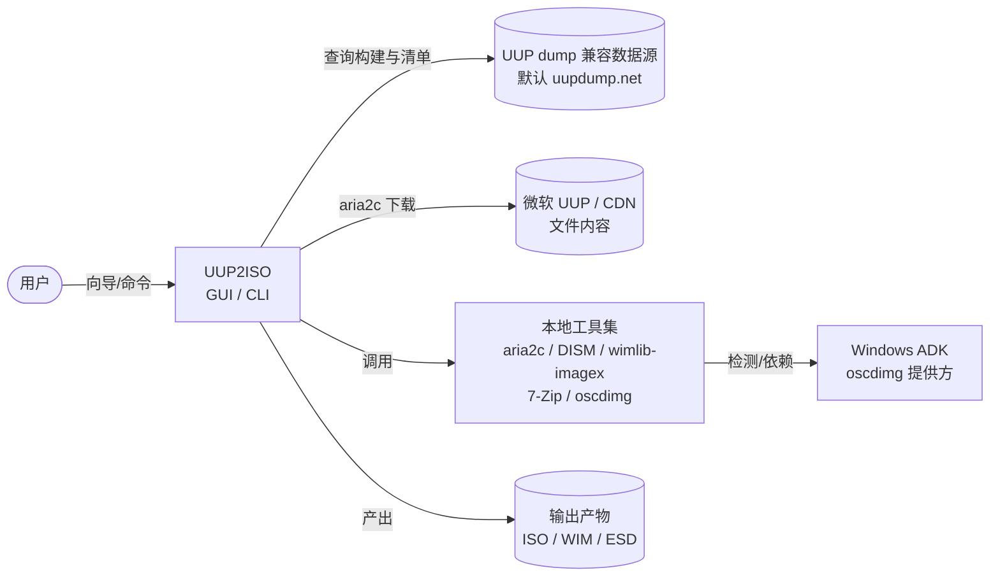

外部依赖：数据源 API（地址可配置）、微软 CDN（内容）、本地工具与 ADK。系统不接触激活/授权服务。

---

## 3. 分层架构图（Container）

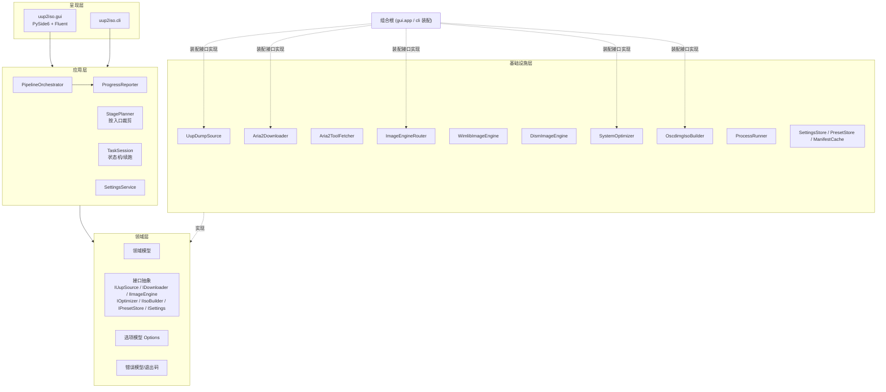

**依赖规则**：`Presentation → Application → Core ← Infrastructure`。Application 只能依赖 Core 定义的接口；Infrastructure 实现这些接口；组合根（Host/DI）负责装配，Application 不直接引用 Infrastructure。

---

## 4. 组件视图（Component）

### 4.1 编排与任务组件

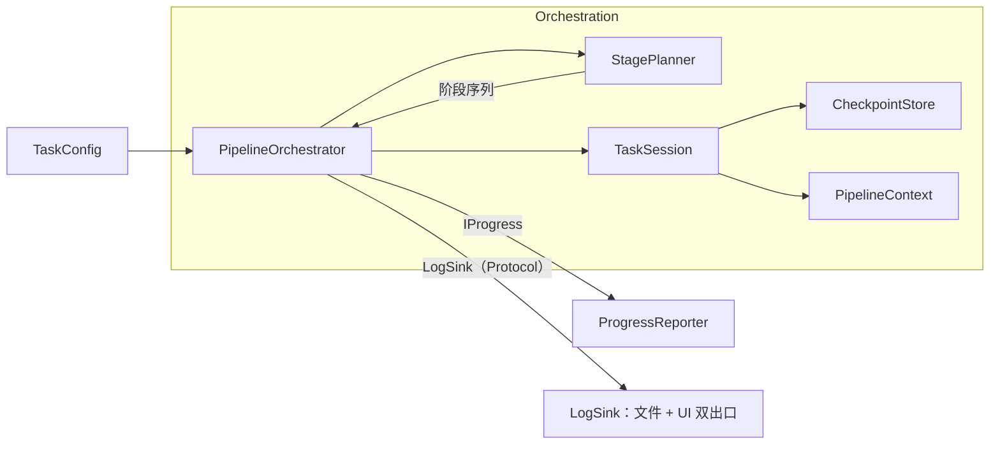

- `StagePlanner` 依据入口（A/B/C）与选项生成阶段序列。
- `TaskSession` 驱动状态机、维护 `PipelineContext`、写检查点以支持续跑。

### 4.2 数据源与下载组件

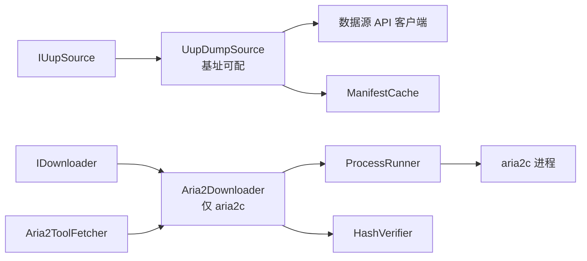

### 4.3 映像与定制组件

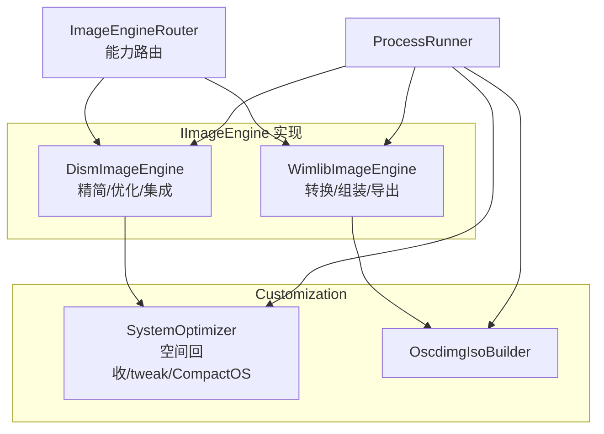

### 4.4 界面组件

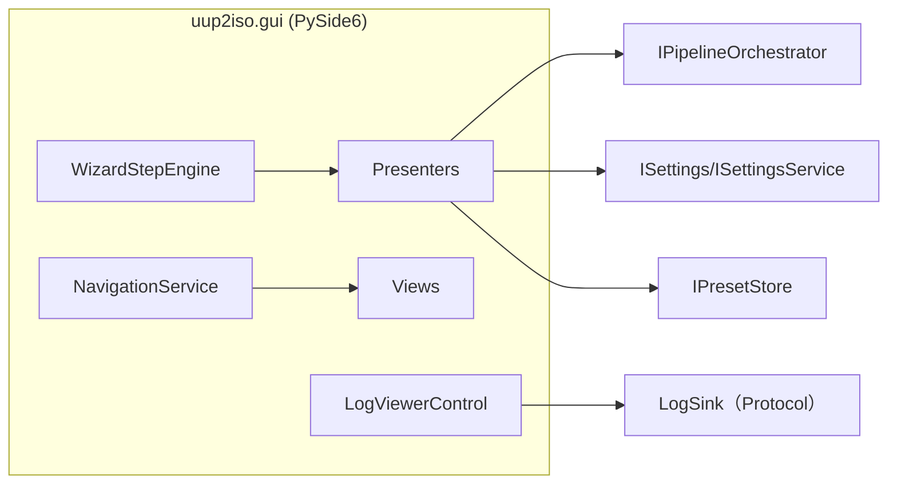

---

## 5. 领域模型类图（Class）

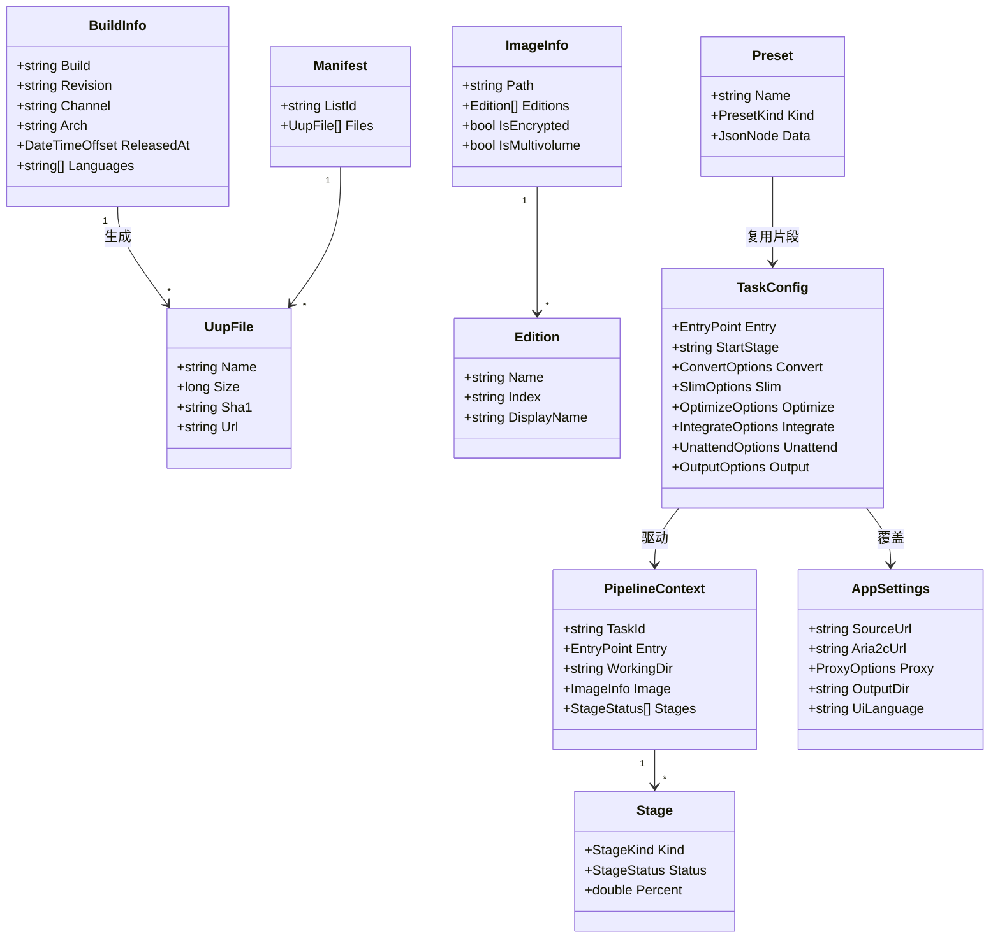

---

## 6. 关键接口依赖图（Interface == Impl）

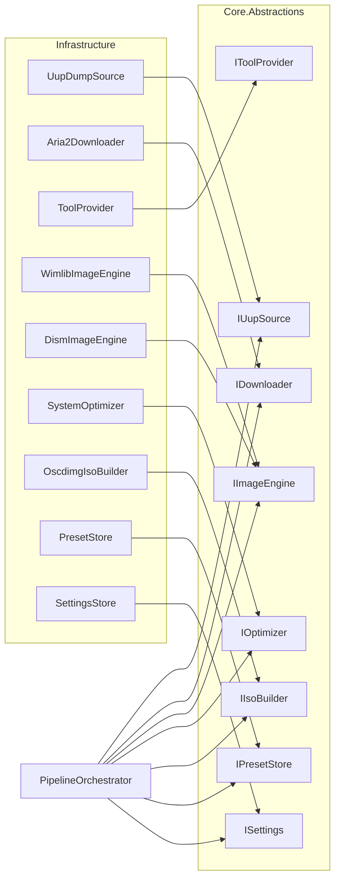

---

## 7. 部署图（Deployment）

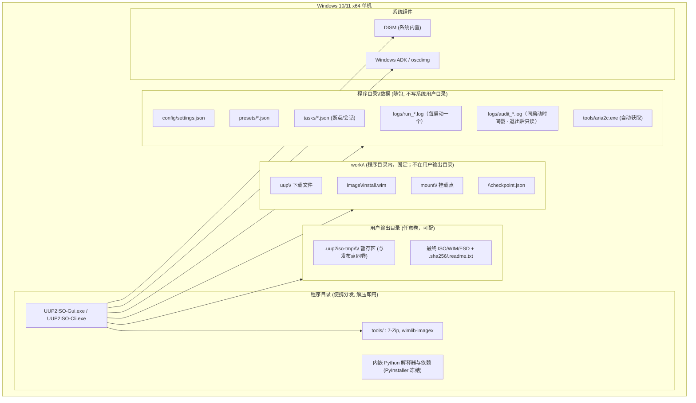

> **便携分发**：程序、`logs/`、`config/`、`presets/`、`tasks/`、`tools/` 全部位于程序目录，不写注册表、不写 `%LocalAppData%`；目录不可写时启动即报错而不改路径。
>
> **开发与构建环境（非部署目标）**：源码仓库工作空间下强制使用 `.venv` 虚拟环境（`python -m venv .venv`）运行一切脚本；PyInstaller 打包同样在 `.venv` 内执行（`.venv\Scripts\python -m PyInstaller uup2iso.spec`），产物体积与启动时间代价已接受。

---

## 8. 外部工具集成图

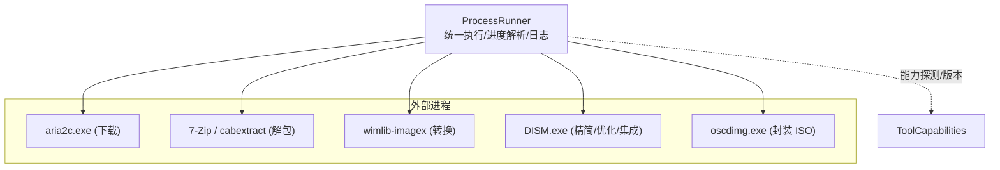

---

## 9. 存储与配置架构

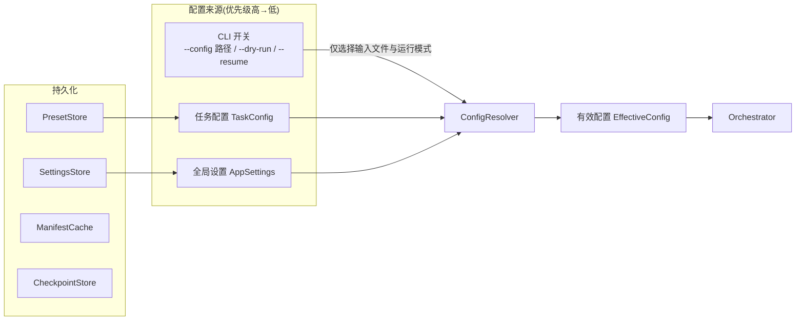

> 合并规则：**任务配置 > 全局设置**。CLI 不做字段级覆盖，只指定 `TaskConfig` 文件与运行开关（`--config` / `--dry-run` / `--resume`）。全局设置里出现的同名项（严格未知字段 / 严格上下文 / 严格失败 / 卡死判定阈值）**只是新建任务时的默认值**（`settings.defaults.*`、`settings.process.*`），任务配置显式给出时以任务为准；设置页因此在文案上标注「作为新任务默认值」。

---

## 10. 多入口阶段矩阵

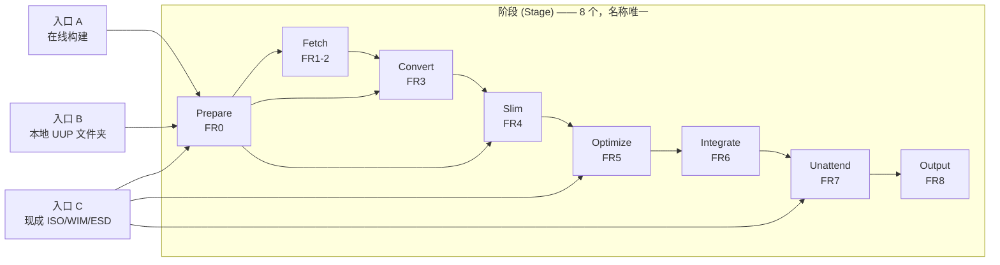

> 入口 A 的 `Prepare` 只做 `uup\` 就绪探测（可与 `Fetch.verify` 合并）；历史名 `DetectInput`/`PrepareImage` 是 `Prepare` 的子步骤，`Validate` 是 `Output.verify` 子步骤，均不是阶段（编排 §2.1）。详见 `软件流程图.md` §2.1。

---

## 11. 包依赖图（Python 子包间）

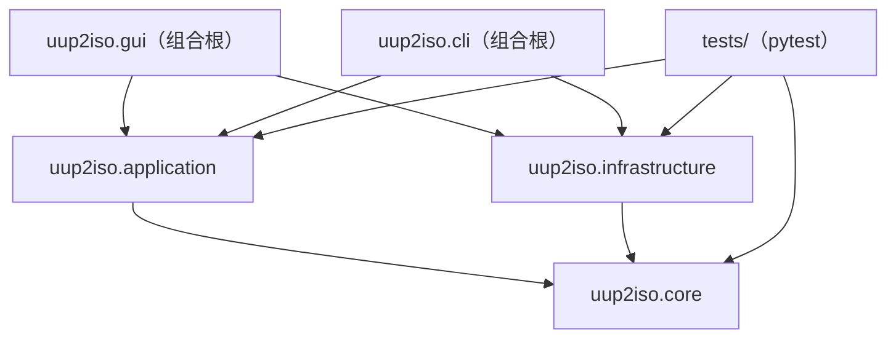

- `core` 无外部依赖（纯模型/接口 Protocol/选项/错误）。
- `application` 仅依赖 `core`，通过 core 中的接口（Protocol）编排流程，**不得**引用 `infrastructure`。
- `infrastructure` 仅依赖 `core`，实现 core 中的接口（进程执行、存储、工具自检、下载、映像、优化）。
- `gui`/`cli` 是**组合根**：负责装配 `application` 与 `infrastructure` 并注入 `LogSink` 等实现。
- `tests/` 可引用 `core`/`application`/`infrastructure`，但不得被产品包引用。
- 依赖方向在 `pyproject.toml`（可选依赖分组）与 CI 中通过 import-linter 类工具强制校验。
