# UUP2ISO 软件流程图

> 版本：v0.7
> 分类：设计（结构与界面） ｜ 目录：`docs/设计/`
> 技术栈：Python 3.12+（PySide6 GUI / PyInstaller 打包），Windows 10/11 x64
> 配套文档：`需求分析.md`、`GUI与框架设计.md`、`软件架构图.md`
> 规范清单、术语与需求映射：`术语表与文档映射.md`
> 渲染说明：本文使用 Mermaid 描述，GitHub、VS Code（Mermaid 插件）、Typora 均可直接渲染。

## 图例

- 圆角矩形 `([ ])`：起点 / 终点
- 矩形 `[ ]`：处理步骤
- 菱形 `{ }`：判断分支
- 括号 `[( )]`：数据 / 存储

---

## 1. 流程清单

| # | 流程 | 关联需求 |
|---|---|---|
| 2 | 总体业务流程（三入口） | FR0 || 3 | 入口 A：在线构建全流程 | FR0/FR1/FR2 |
| 4 | 入口 B：本地 UUP 文件夹 | FR0.3 |
| 5 | 入口 C：现成 ISO/WIM/ESD | FR0.4 |
| 6 | 数据源查询与清单生成 | FR1.4/FR1.5 |
| 7 | 下载（aria2c） | FR2 |
| 8 | 依赖自检与 aria2c 自动获取 | FR2.2/FR10.3 |
| 9 | 转换（CAB/PSF→WIM→ISO） | FR3 |
| 10 | 精简 | FR4 |
| 11 | 系统优化 | FR5 |
| 12 | 集成 | FR6 |
| 13 | 无人值守生成 | FR7 |
| 14 | 输出与校验 | FR8 |
| 15 | 任务状态机与断点续跑 | FR9 |
| 16 | GUI 向导流转 | FR10.1 |
| 17 | 错误处理与重试 | 非功能・健壮性 |
| 18 | 配置/预设加载 | FR9.1 |
| 19 | 单实例校验与日志初始化 | FR9.4 / 日志规范 |
| 20 | 一键打包诊断 | FR9.5 / 日志规范 §7 |

> 合计 **19 条**：流程 2–18 为 17 条主流程，19 为单实例、20 为诊断包；编号与正文 `## N.` 章节号一一对应，增删流程必须同步改编号与本节。

---

## 2. 总体业务流程（三入口）

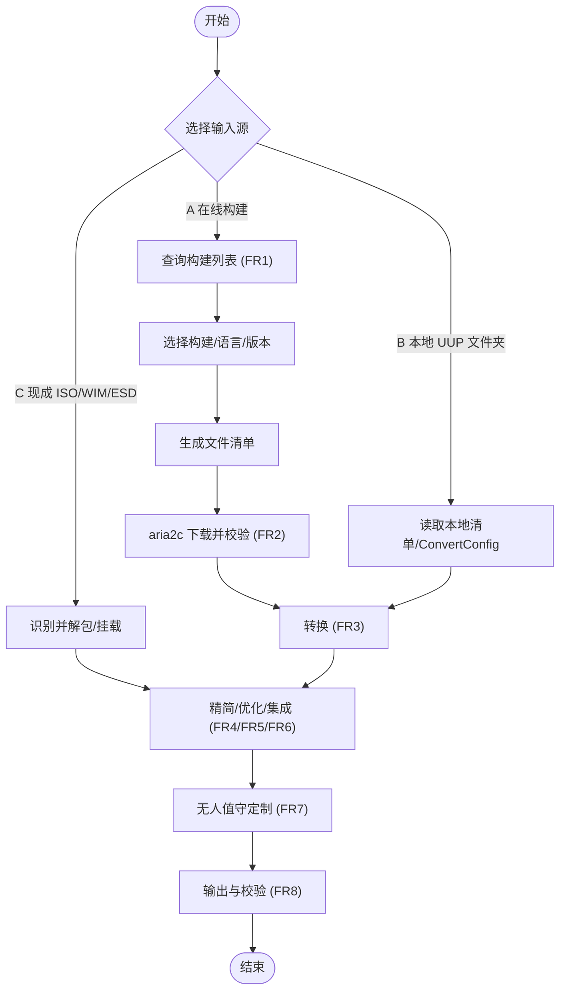

### 2.1 阶段归一化与入口裁剪

代码实现归一为**编排规范定义的 8 个阶段**（编排 §2，名称唯一），由 `StagePlanner` 按入口裁剪：

| 顺序 | 阶段 | 说明 | 历史别名（已降级为子步骤，不再是阶段） |
|---|---|---|---|
| P0 | `Prepare` | 输入嗅探、ESD 物化、ISO 解包、准备自检 | `DetectInput` → `probe`；`PrepareImage` → `materialize` / `extract` |
| P1 | `Fetch` | 数据源查询、清单生成与下载（入口 A/B） | — |
| P2 | `Convert` | CAB 解包、组件聚合、骨架与 `boot.wim`（入口 A/B） | — |
| P3 | `Slim` | 精简（FR4） | — |
| P4 | `Optimize` | 系统优化（FR5） | — |
| P5 | `Integrate` | 集成（FR6） | — |
| P6 | `Unattend` | 无人值守生成与可选注入（FR7） | — |
| P7 | `Output` | 输出、封装、分级校验（FR8） | `Validate` → `verify` 子步骤 |

- 入口 A：`Fetch → Convert → Slim → Optimize → Integrate → Unattend → Output`（`Prepare` 只做 `uup\` 就绪探测，可与 `Fetch.verify` 合并）
- 入口 B：`Prepare → Convert → Slim → Optimize → Integrate → Unattend → Output`
- 入口 C：`Prepare → Slim → Optimize → Integrate → Unattend → Output`（按所选起始阶段裁剪中间段）

> 口径：`skipped` 只用于「按配置无需执行」（如未选精简项）；**未实现的阶段必须显式失败**，不得借 `skipped` 掩盖。阶段与子步骤的检查点规则见编排 §3。

---

## 3. 入口 A：在线构建全流程

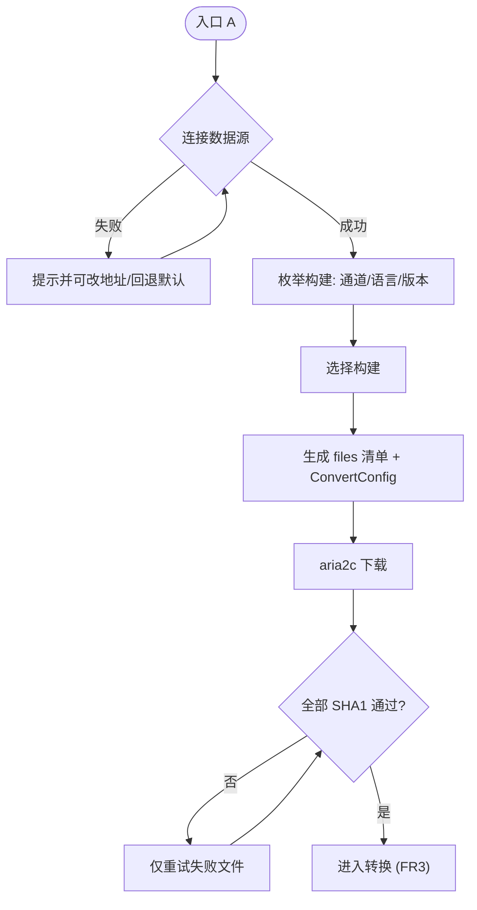

---

## 4. 入口 B：本地 UUP 文件夹（从转换开始）

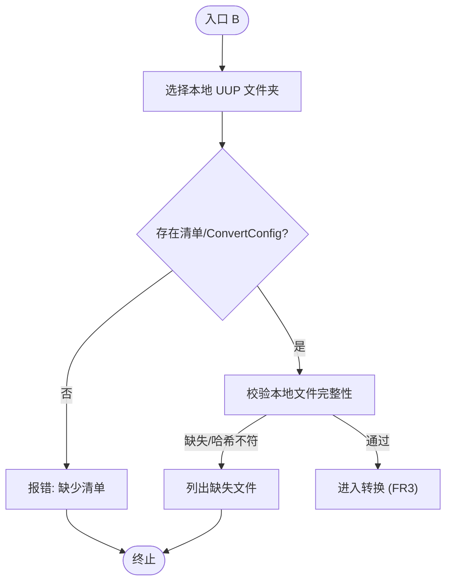

---

## 5. 入口 C：现成 ISO/WIM/ESD（从精简/优化/定制开始）

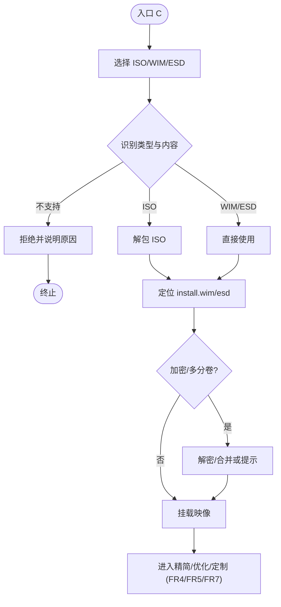

---

## 6. 数据源查询与清单生成

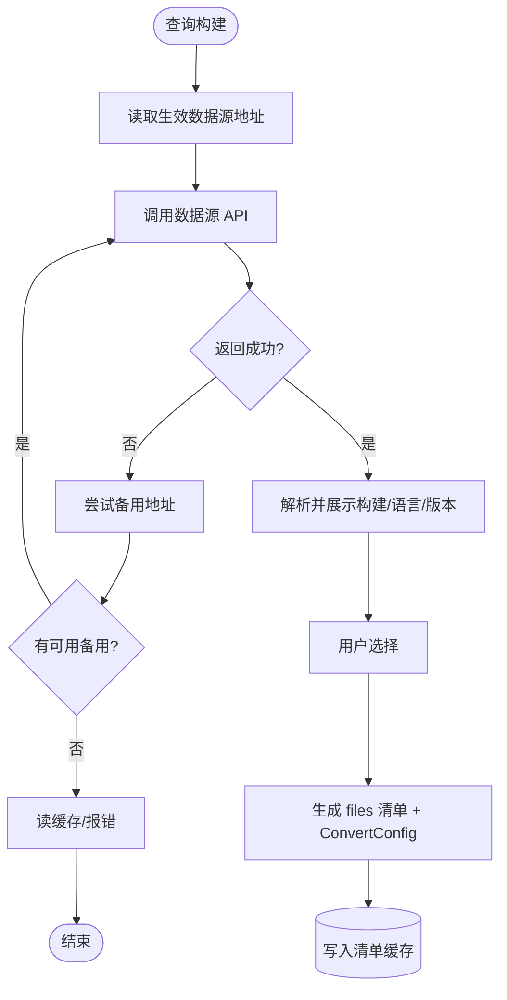

---

## 7. 下载流程（aria2c，无降级）

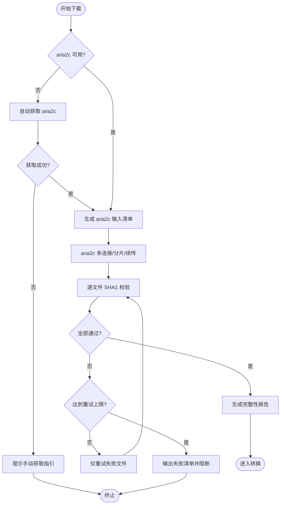

---

## 8. 依赖自检与 aria2c 自动获取

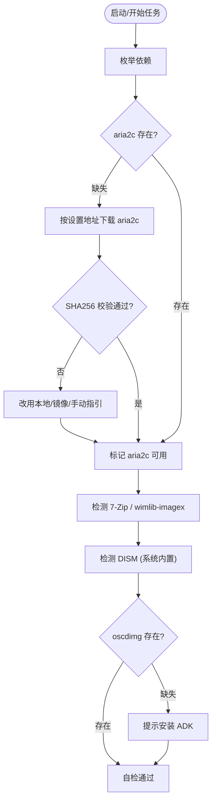

---

## 9. 转换流程（CAB/PSF → WIM → ISO）

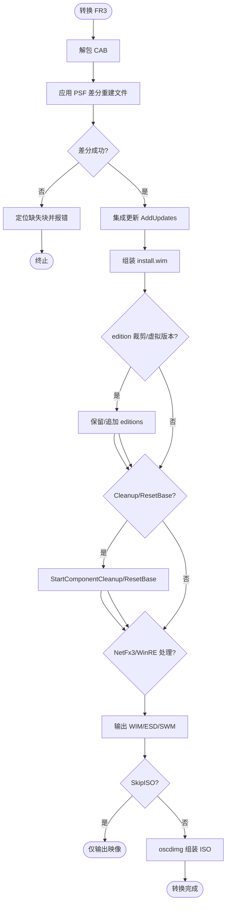

---

## 10. 精简流程（FR4）

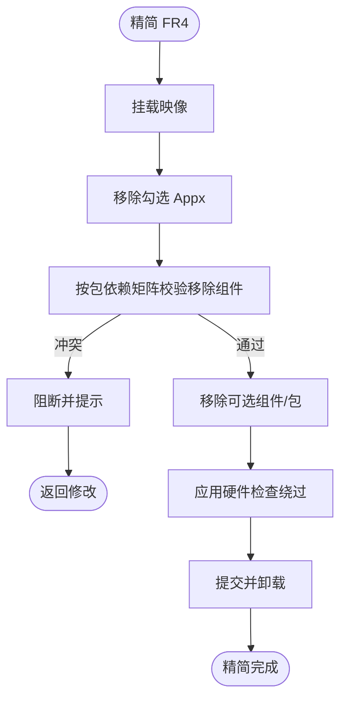

---

## 11. 系统优化流程（FR5，DISM++ 式）

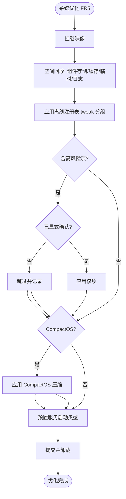

---

## 12. 集成流程（FR6）

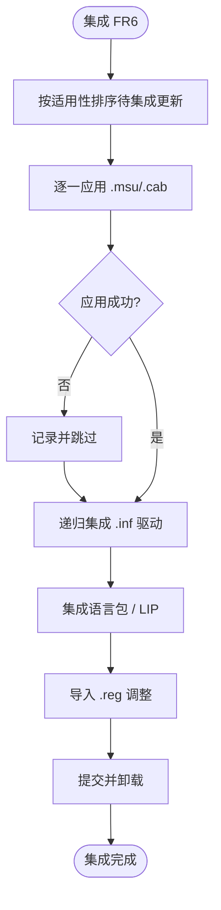

---

## 13. 无人值守生成流程（FR7）

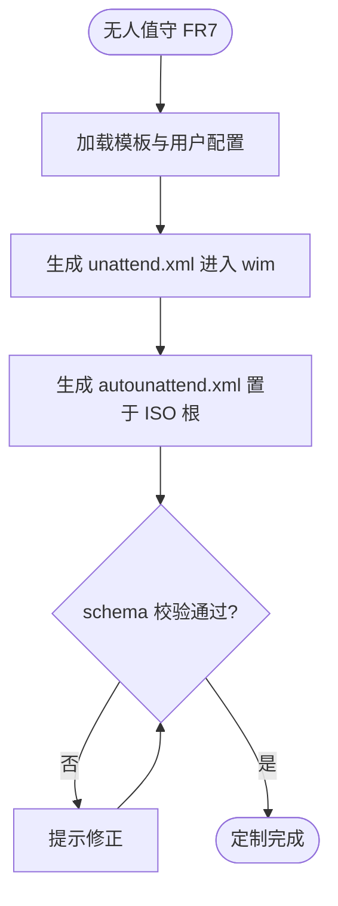

---

## 14. 输出与校验流程（FR8）

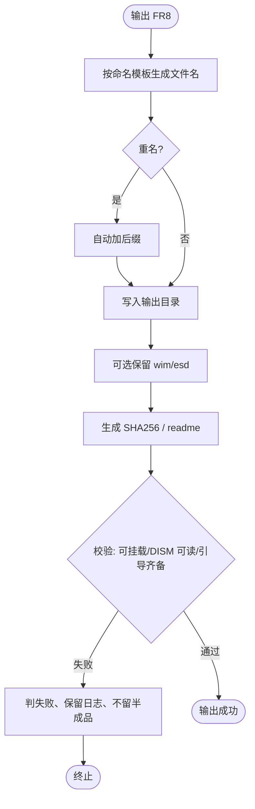

---

## 15. 任务状态机与断点续跑（FR9）

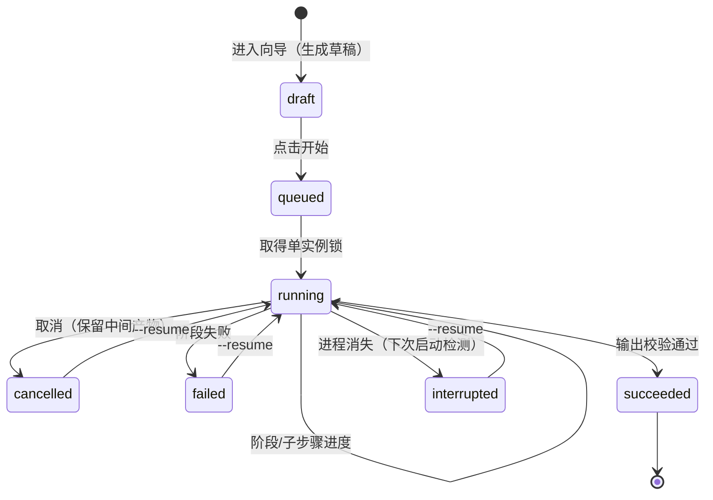

续跑：`CheckpointStore` 持久化当前阶段、已完成文件哈希与选项；重启后从检查点恢复（对应 `--resume`）。
状态取值与术语表 §2.2 一致，**不支持「暂停/继续」**（编排 §13 开放问题），暂停语义只能由「取消 + 续跑」实现。

---

## 16. GUI 向导流转（FR10.1）

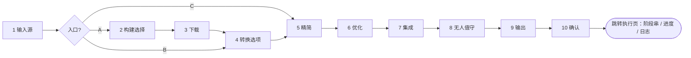

- **共 10 步**（与 `GUI交互规格-向导页.md` §1.2、§2 一致）；⑩ 是「确认」，执行与日志在同级**执行页**（`GUI交互规格-设置与对话框.md` §6），不占向导步骤。
- 入口 B/C 跳过的步骤在步骤条中灰显（不可用），隐藏的步骤不占位。
- 任一步可「保存任务配置」；三档模式（简单/标准/专家）在向导右上角切换。

---

## 17. 错误处理与重试（非功能・健壮性）

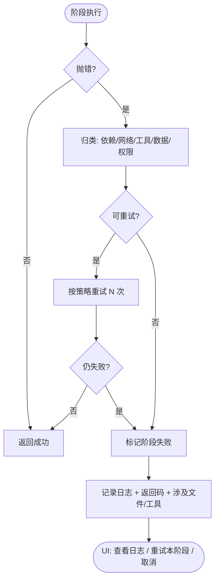

退出码：0 成功｜1 完成但有警告｜2 阶段失败｜3 用户取消｜4 参数/依赖错误｜5 已有实例运行。

---

## 18. 配置 / 预设加载（FR9.1）

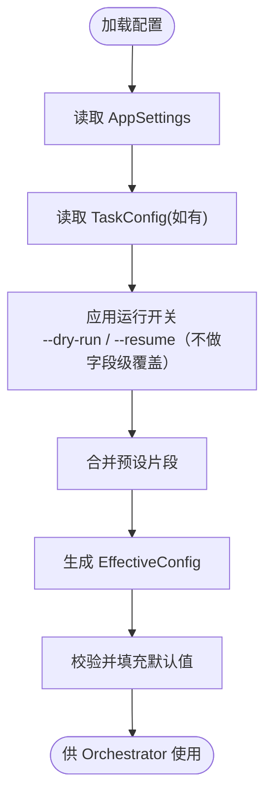

优先级：**任务配置 > 全局设置**。CLI 仅指定 `TaskConfig` 文件与运行开关（`--config` / `--dry-run` / `--resume`），不存在字段级参数覆盖。

---

## 19. 单实例校验与日志初始化（FR9.4 / 日志规范）

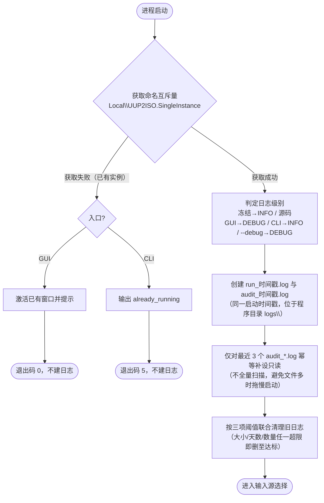

> 冲突实例不创建日志文件、不执行清理、不写审计；清理失败只记 `WARN`，不阻断主流程。详见 `日志规范.md` §4、§6。

---

## 20. 一键打包诊断（FR9.5）

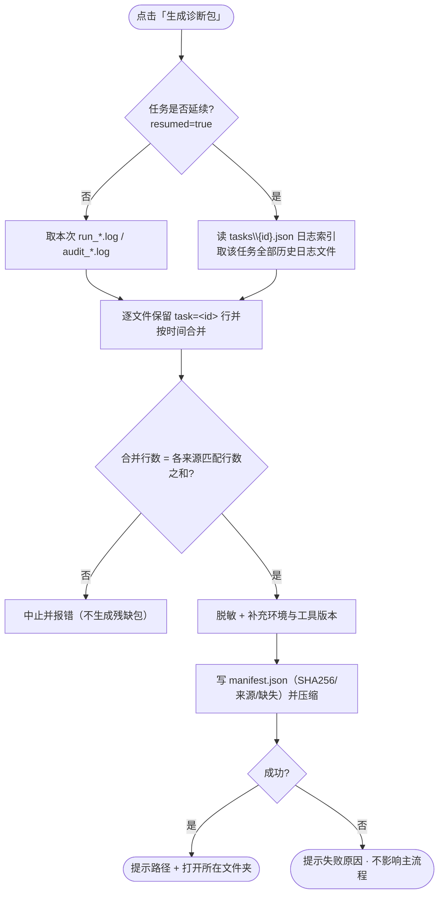

- **范围按任务判定**：单次任务只含本次运行日志；延续任务含该任务全部历史日志。取文件靠 `tasks\{task_id}.json` 索引，**不扫描目录**——不漏（索引覆盖每次运行）且不多（按 `task=<id>` 行过滤）。
- 索引内文件已被清理时：`manifest.missing` 记录、`exact=false`，界面提示历史不完整。
- 默认保存到 `{程序目录}\logs\`，与运行日志同池、共用清理阈值；纯本地不上传，排除 ISO/WIM/ESD 与工具二进制。
