# UUP2ISO 软件流程图

> 版本：v0.1（草案）
> 配套文档：`需求分析.md`、`GUI与框架设计.md`、`软件架构图.md`
> 渲染说明：本文使用 Mermaid 描述，GitHub、VS Code（Mermaid 插件）、Typora 均可直接渲染。

## 图例

- 圆角矩形 `([ ])`：起点 / 终点
- 矩形 `[ ]`：处理步骤
- 菱形 `{ }`：判断分支
- 括号 `[( )]`：数据 / 存储

---

## 1. 流程清单

| # | 流程 | 关联需求 |
|---|---|---|
| 2 | 总体业务流程（三入口） | FR0 |
| 3 | 入口 A：在线构建全流程 | FR0/FR1/FR2 |
| 4 | 入口 B：本地 UUP 文件夹 | FR0.3 |
| 5 | 入口 C：现成 ISO/WIM/ESD | FR0.4 |
| 6 | 数据源查询与清单生成 | FR1.4/FR1.5 |
| 7 | 下载（aria2c） | FR2 |
| 8 | 依赖自检与 aria2c 自动获取 | FR2.2/FR10.3 |
| 9 | 转换（CAB/PSF→WIM→ISO） | FR3 |
| 10 | 精简 | FR4 |
| 11 | 系统优化 | FR5 |
| 12 | 集成 | FR6 |
| 13 | 无人值守生成 | FR7 |
| 14 | 输出与校验 | FR8 |
| 15 | 任务状态机与断点续跑 | FR9 |
| 16 | GUI 向导流转 | FR10.1 |
| 17 | 错误处理与重试 | 非功能・健壮性 |
| 18 | 配置/预设加载 | FR9.1 |

---

## 2. 总体业务流程（三入口）

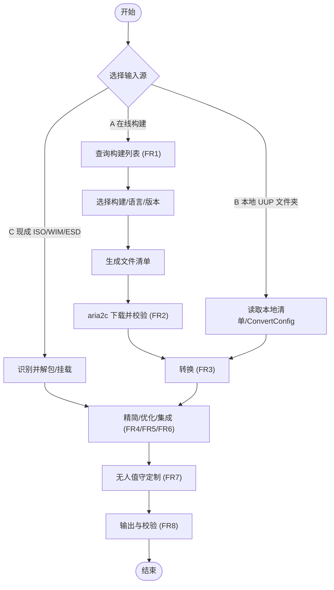

---

## 3. 入口 A：在线构建全流程

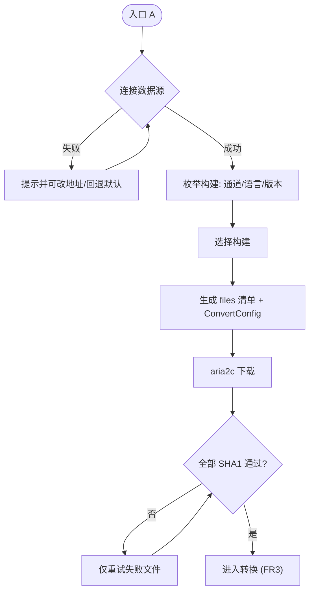

---

## 4. 入口 B：本地 UUP 文件夹（从转换开始）

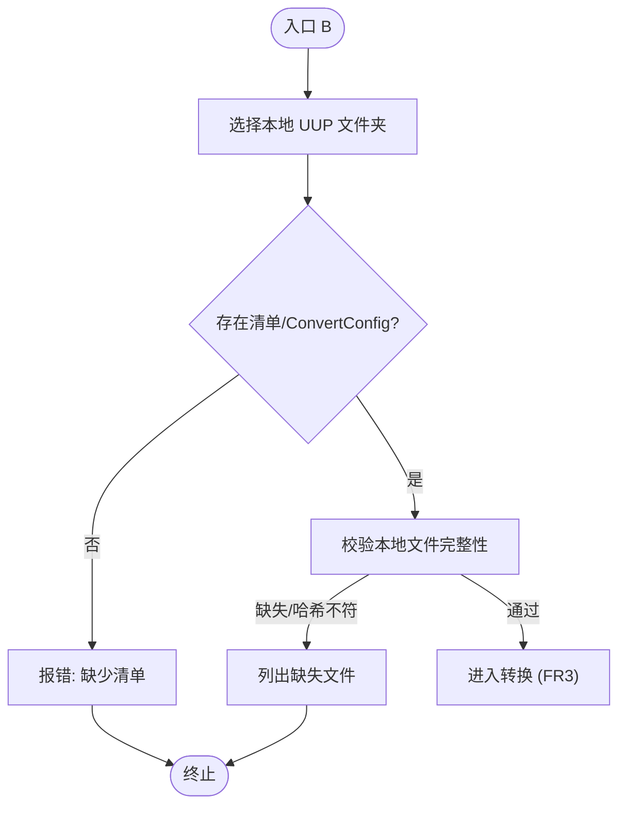

---

## 5. 入口 C：现成 ISO/WIM/ESD（从精简/优化/定制开始）

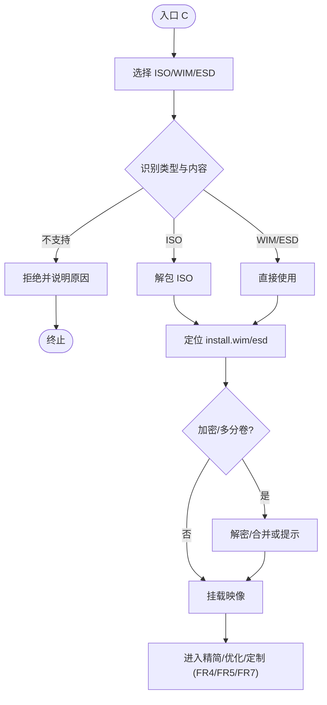

---

## 6. 数据源查询与清单生成

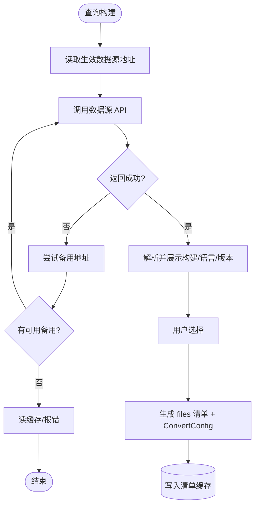

---

## 7. 下载流程（aria2c，无降级）

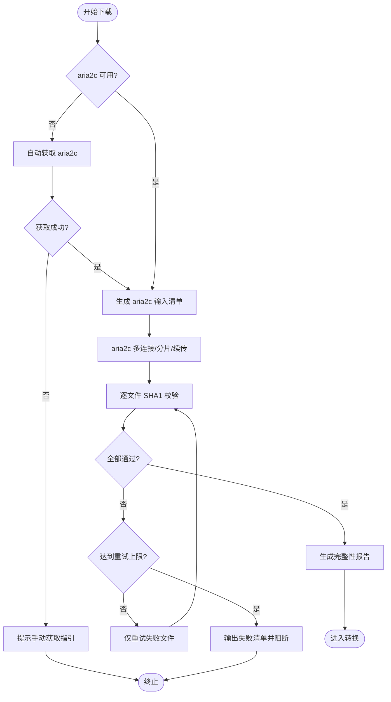

---

## 8. 依赖自检与 aria2c 自动获取

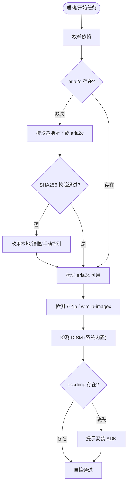

---

## 9. 转换流程（CAB/PSF → WIM → ISO）

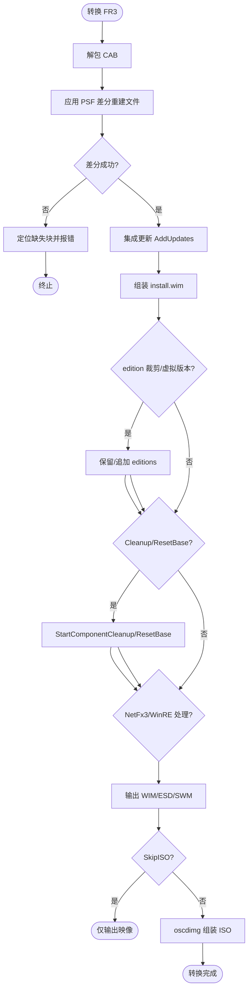

---

## 10. 精简流程（FR4）

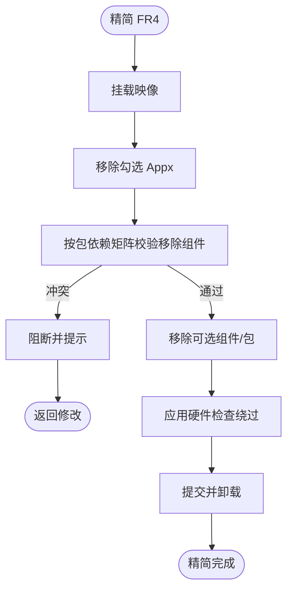

---

## 11. 系统优化流程（FR5，DISM++ 式）

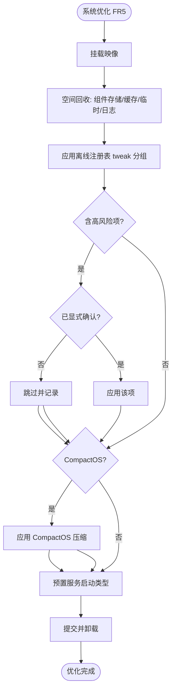

---

## 12. 集成流程（FR6）

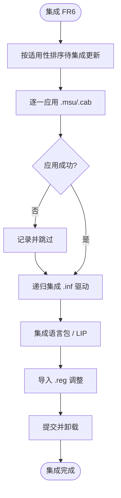

---

## 13. 无人值守生成流程（FR7）

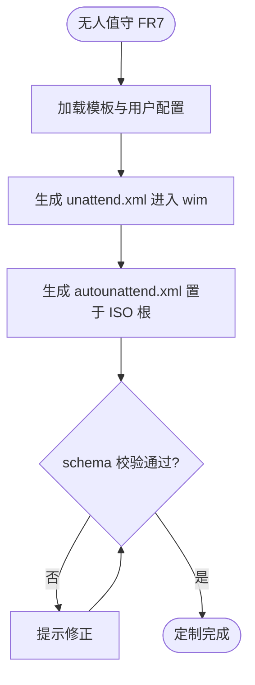

---

## 14. 输出与校验流程（FR8）

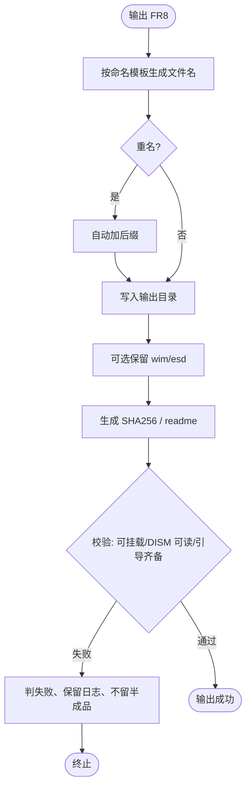

---

## 15. 任务状态机与断点续跑（FR9）

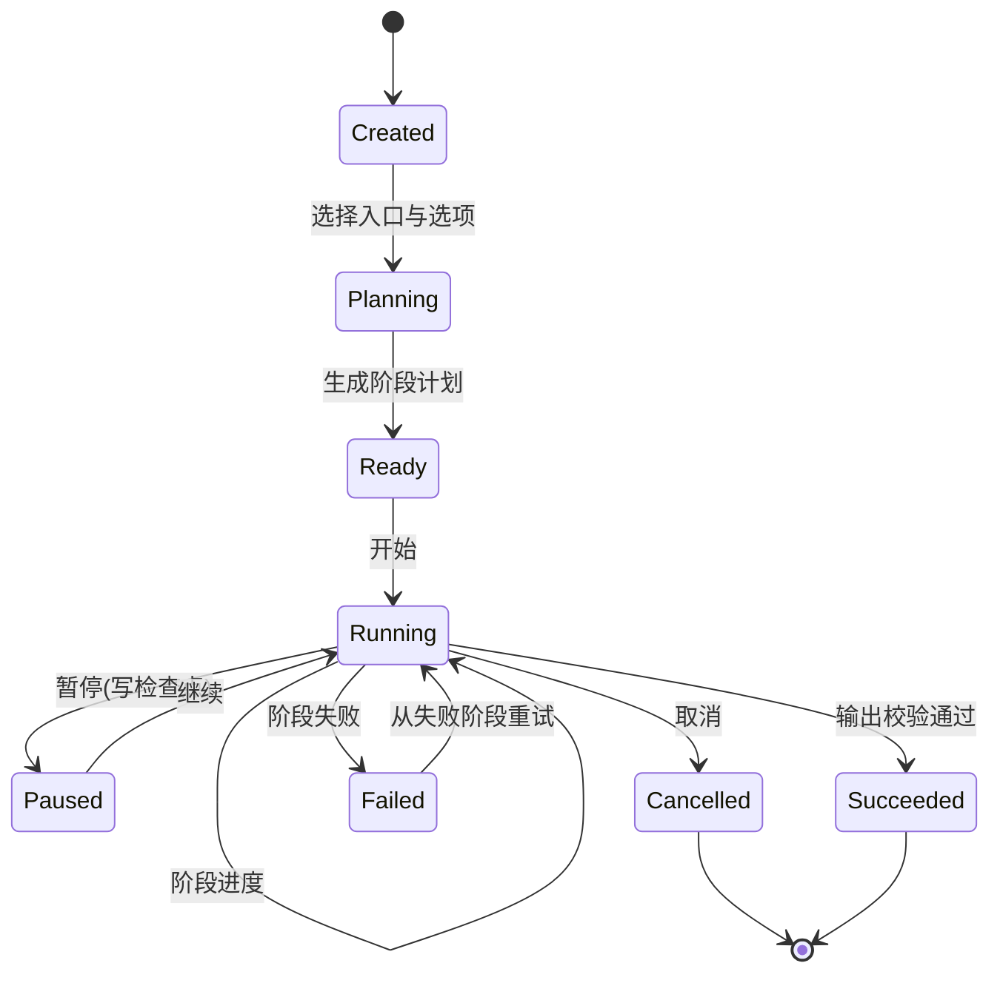

续跑：`CheckpointStore` 持久化当前阶段、已完成文件哈希与选项；重启后从检查点恢复（对应 `--resume`）。

---

## 16. GUI 向导流转（FR10.1）

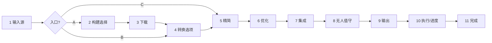

- 入口 B/C 跳过的步骤在步骤条中灰显（不可用）。
- 任一步可「保存任务配置」，高级模式可展开底层参数。

---

## 17. 错误处理与重试（非功能・健壮性）

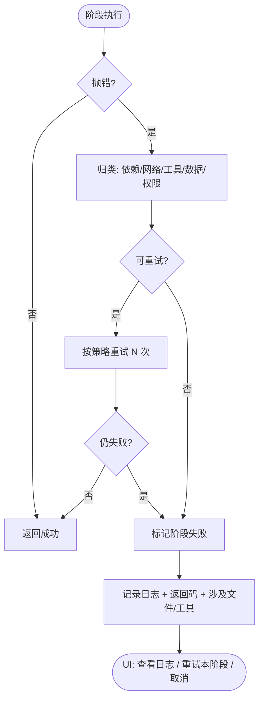

退出码：0 成功｜1 完成但有警告｜2 阶段失败｜3 用户取消｜4 参数/依赖错误。

---

## 18. 配置 / 预设加载（FR9.1）

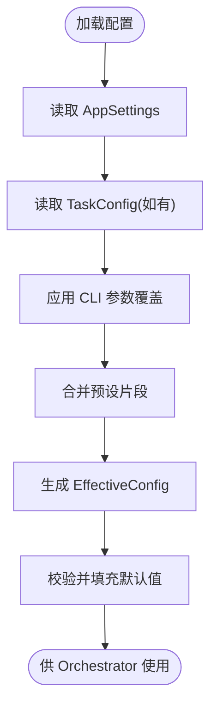

优先级：**CLI 参数 / 任务配置 > 全局设置**。
